# ACC Race Stats

### [Versão em português →](README.md)

**Race charts for Assetto Corsa Competizione leagues, straight from your game server.** Pick an event from a list and
get up to 16 charts and a summary for your league chat. Windows, macOS and Linux, in Portuguese and English.

## Step by step

No technical knowledge needed: you click, type a number and press Enter.

### 1. Download

**[⬇ Download ACC Race Stats (zip)](https://github.com/fclesio/acc-race-stats/archive/refs/heads/main.zip)**

### 2. Unzip

- **Windows:** right-click the downloaded file → **Extract All…** → **Extract**.
- **macOS:** double-click the downloaded file (Safari often unzips it by itself).
- **Linux:** right-click the downloaded file → **Extract Here**.

Always open the program from the new folder, not from inside the zip file.

### 3. Start it

In the new folder, open the file of your system. A window with text opens: that is where the program asks its questions.


Only the first time:

- **Windows** may ask whether to run a file from the internet: click **More info → Run anyway**, or **Run**.
- **macOS** may say the file is from an unidentified developer: right-click `ACC-Race-Stats.command` → **Open** → **Open**.
  On macOS 15 and later: **System Settings → Privacy & Security → Open Anyway**.
- The program then downloads what it needs by itself, which can take a few minutes. There is nothing to install.

### 4. Keep the server panel open

The program asks for the **FTP** access of your server. Open the panel of your server host (here, G-Portal) on the
**access data** page and keep it next to the program: you copy the IP, port, user name and password from there.

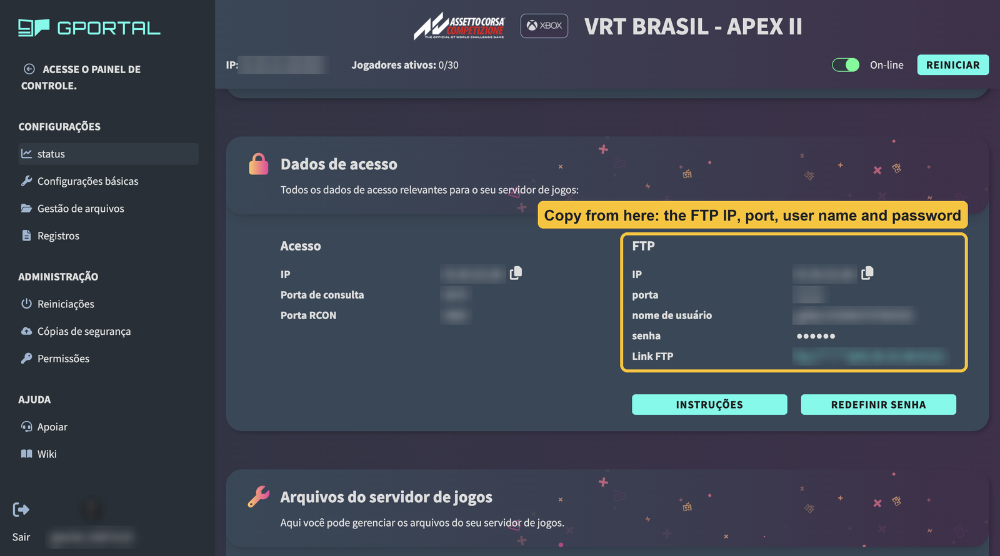

### 5. Answer the questions

Type the answer and press **Enter**; in the images, what you type is yellow and the hints are green. For menus, type
only the number. For the **FTP address**, type the IP and the port of the FTP block of the panel, with a colon between
them (`IP:port`). The password shows only asterisks.

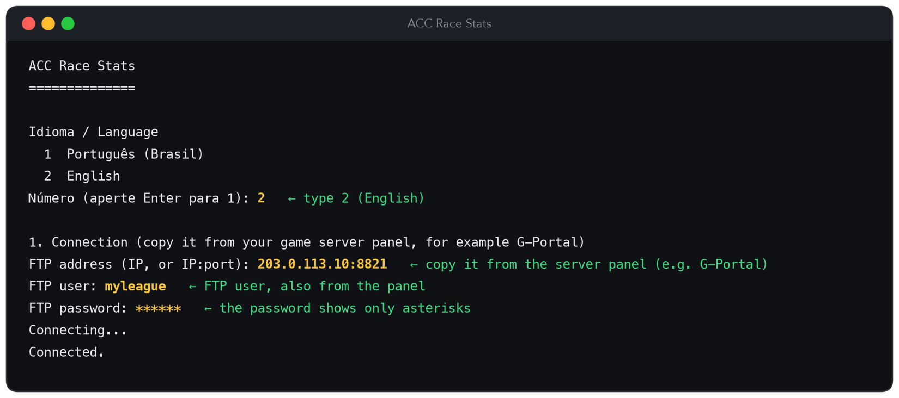

Pick the event, newest first, and what to draw:

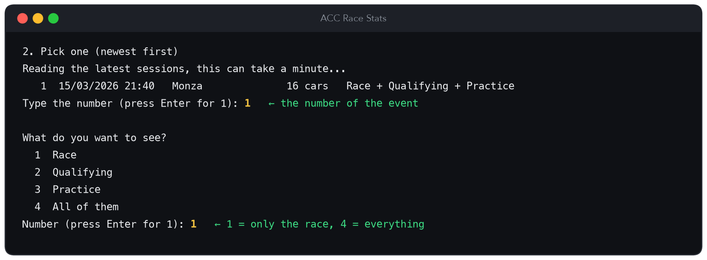

Categories, league name, and whether to save the answers. Choose **1** to save: next time it asks almost nothing.

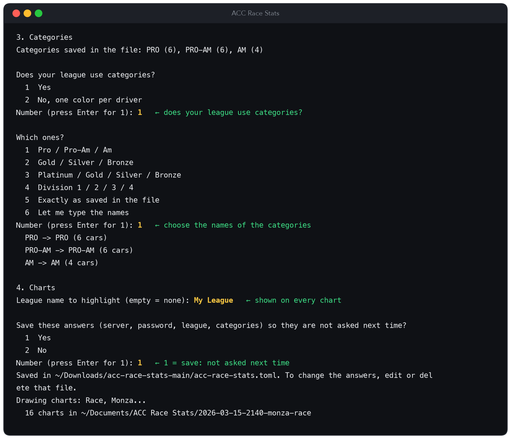

### 6. Done

The folder with the charts opens by itself. Everything of the session is there: the charts, `summary.txt` to paste in the
league chat, and `race.json` with the data. All results are in **Documents → ACC Race Stats**.

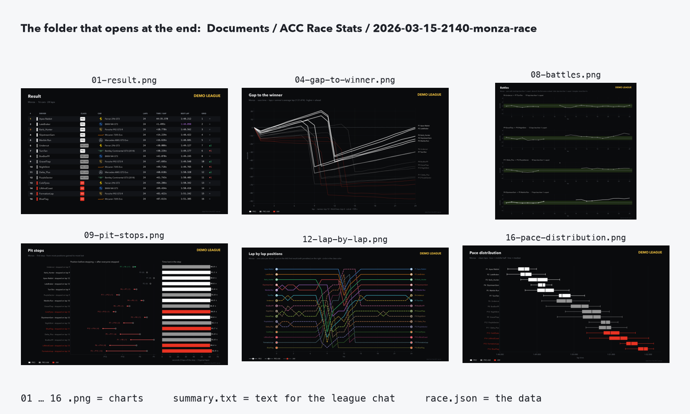

### Next time

Open the same file again. With the answers saved, it connects by itself and only asks which event to draw:

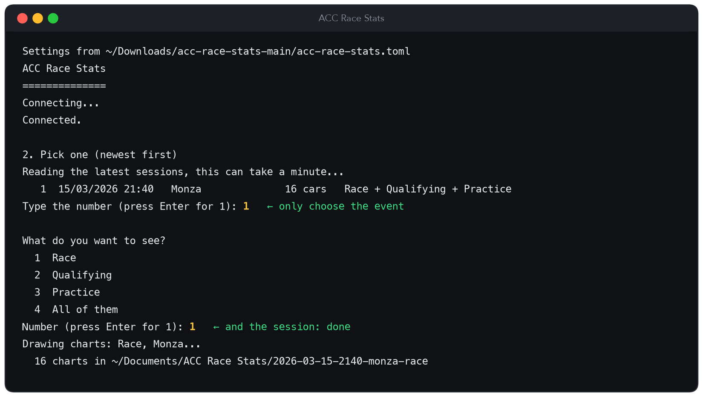

To change the saved answers, open `acc-race-stats.toml` in the program folder with any text editor, or delete it to be
asked everything again. Something went wrong? See [troubleshooting](docs/troubleshooting.md).

## The charts

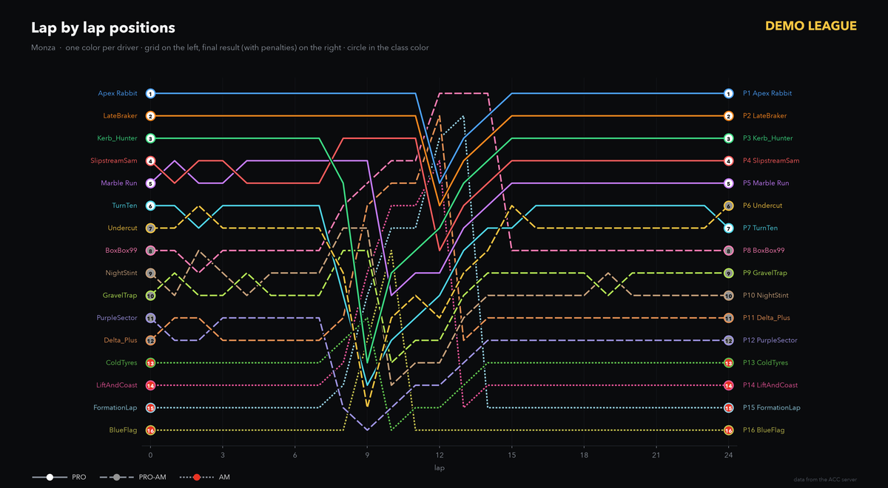

| | |
|---|---|
| 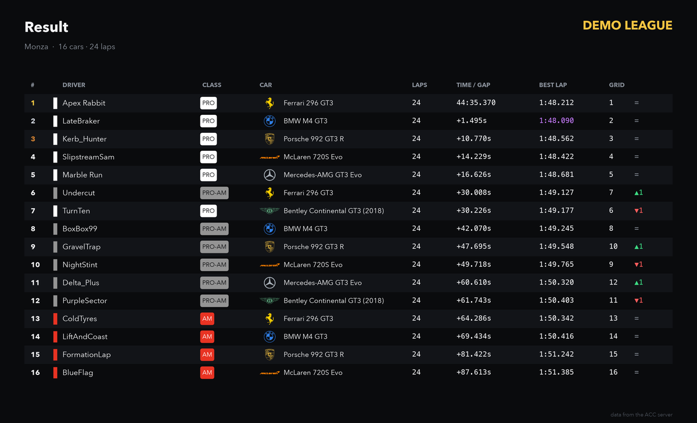 | 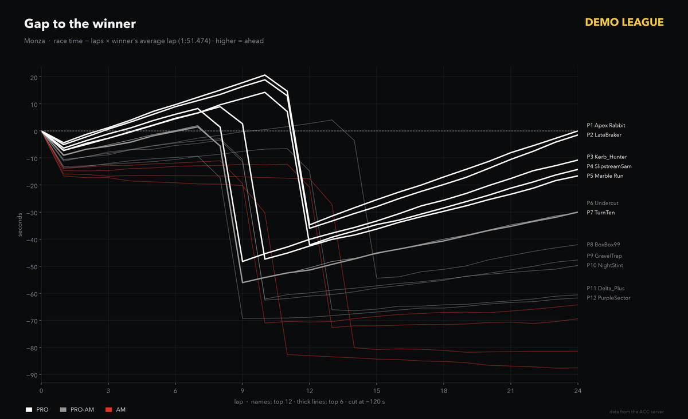 |
| 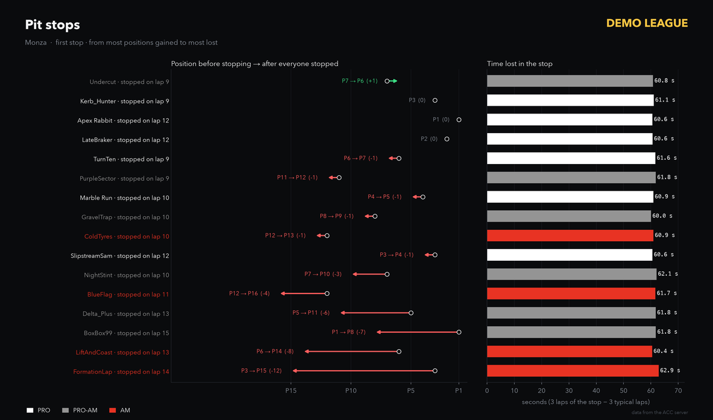 | 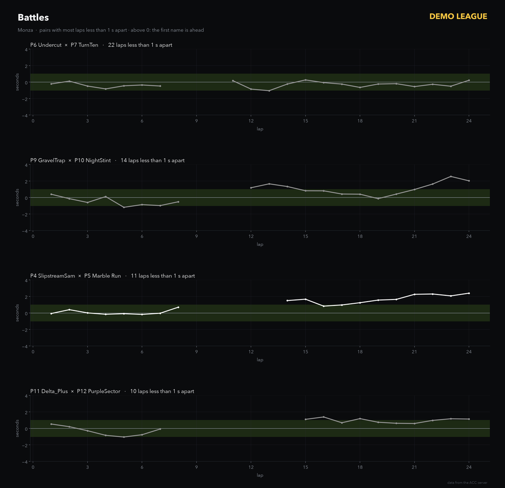 |

All images come from an invented race (`./run.sh demo`). See [every chart explained](docs/charts.md).

## From a terminal

[](pyproject.toml)
[](LICENSE)
[](https://www.conventionalcommits.org/en/v1.0.0/)

The double-click files call `run.sh` (macOS, Linux) or `make.bat` (Windows). They need only `sh` and `curl` (or `wget`),
or PowerShell on Windows: no `make`, Python or developer tools. The first run installs
[uv](https://docs.astral.sh/uv/), Python and the libraries, without changing the shell profile or the `PATH`.

| Command | What it does |
|---|---|
| `./run.sh` or `make` (Windows: `make` or `.\make`) | asks the language (Portuguese by default), then everything else |
| `./run.sh en` / `./run.sh pt-br` | same, in English / Portuguese (`make en`, `make pt-br`) |
| `./run.sh demo` | an invented race weekend, no server needed (`make demo`) |
| `./run.sh --league "My League" …` | any [option](docs/usage.md) (`make ARGS='…'`) |

## Settings file

The first guided run offers to save your answers in `acc-race-stats.toml`, in the project folder; nothing has to be
written by hand. To change them, open that file in any text editor, or delete it to be asked everything again. It can
also be written from [`acc-race-stats.example.toml`](acc-race-stats.example.toml). Every line is optional: what is in the
file is not asked, and options typed on the command line win.

```toml
[server]
address = "203.0.113.10:8821"
user = "myuser"
password = "my-ftp-password"

[report]
language = "pt-br"
league = "My League"
divisions = "pro"
```

The file holds your FTP password in plain text: do not share it. The program makes it readable only by your user on
macOS and Linux, and it is in `.gitignore`. If the password changes on the server, the program asks for the new one
and updates the file. Leave `password` out to be asked every time. See [all settings](docs/usage.md#settings-file).

## Features

- **Made for league admins.** A double-click launcher, numbered menus, a remembered server, an optional settings file
  and clear errors: it says whether the server did not answer or the password is wrong.
- **Events, not files.** A race is listed together with its qualifying and practice; the grid comes from qualifying.
- **Categories your way.** Pro/Pro-Am/Am, Gold/Silver/Bronze, divisions, your own names, or one color per driver.
- **A correct race clock.** Positions and gaps include the time from the green light to the line, and impossible first
  laps are rebuilt. See [how it works](docs/race-clock.md).
- **Fast on slow servers.** Reads only the files it needs and keeps what it already downloaded.
- **Private.** The password is only kept if you write it in your settings file, and player ids never reach the output.

## Documentation

| Page | |
|---|---|
| [Usage](docs/usage.md) | every option, driver lists, starting grids, categories |
| [Charts](docs/charts.md) | what each chart shows and how it is calculated |
| [How to read the charts](docs/graficos.md) | every chart explained with the winner of a real race (in Portuguese) |
| [Race clock](docs/race-clock.md) | why adding up lap times is wrong, and the fix |
| [race.json](docs/race-json.md) | data format |
| [Architecture](docs/architecture.md) | modules and design decisions |
| [Troubleshooting](docs/troubleshooting.md) | common problems |
| [Contributing](CONTRIBUTING.md) | development, commits and versions |
| [Changelog](CHANGELOG.md) | what changed in each version |

## Status

The current version is 0.1.2; see the [changelog](CHANGELOG.md). It was developed and tested on macOS; the CI workflow
runs the same tests and launchers on Windows and Linux. Problems on those systems are the most welcome reports.

## License

[MIT](LICENSE). Brand logos come from [Simple Icons](https://simpleicons.org); see [NOTICE](NOTICE.md). This project is
not affiliated with Kunos Simulazioni, the game server hosts or the car brands.
