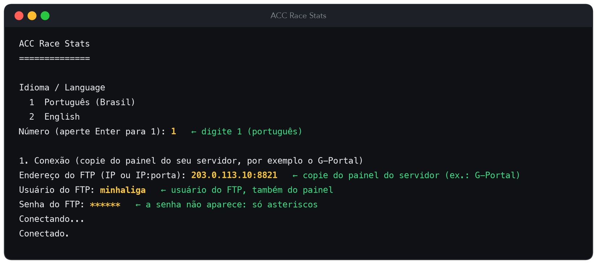
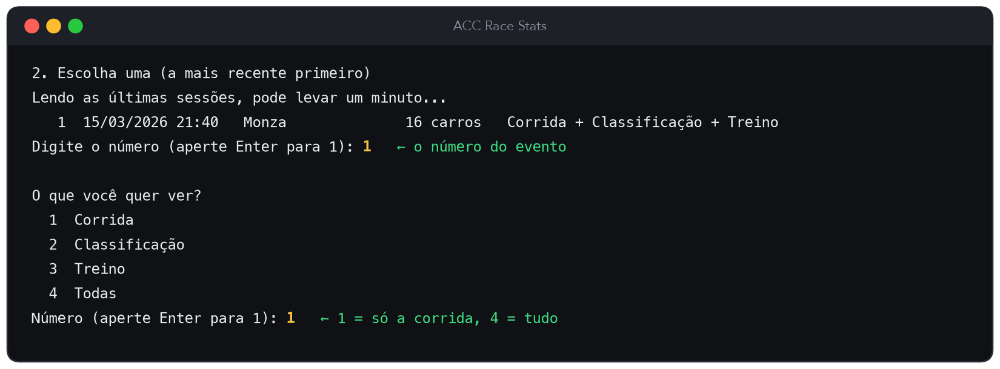
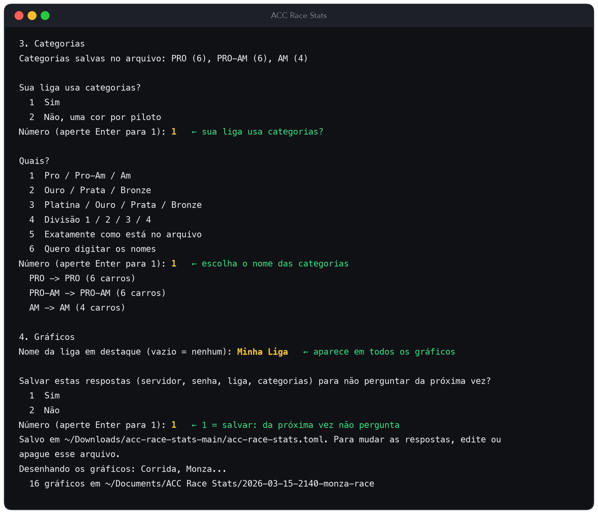
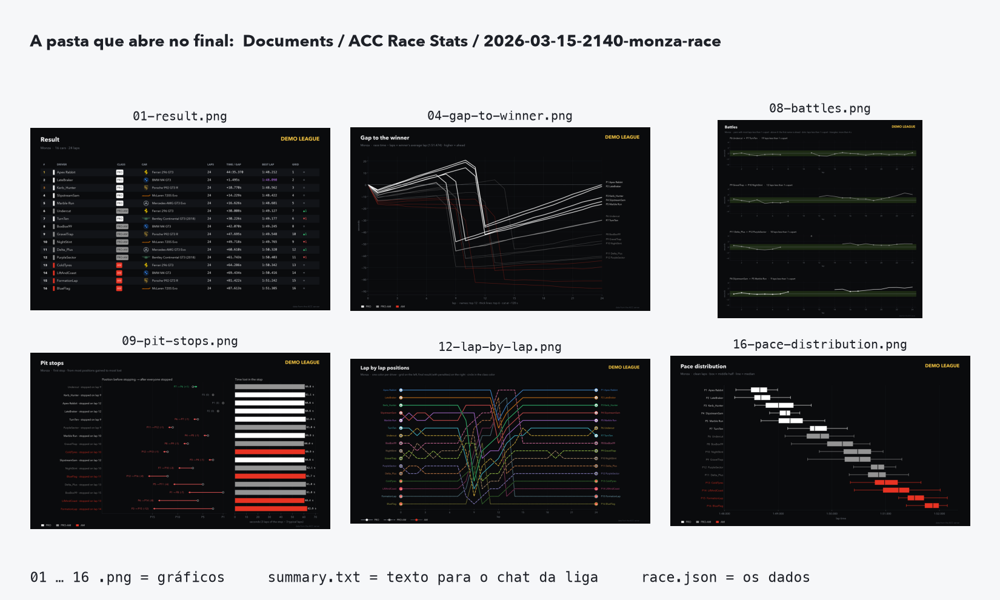
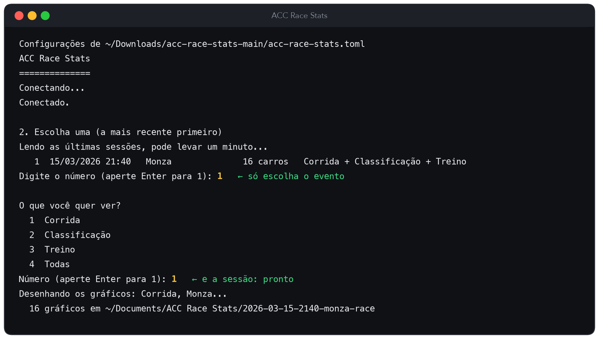
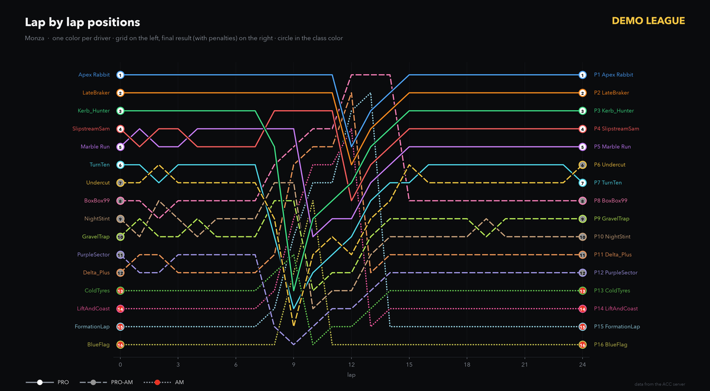
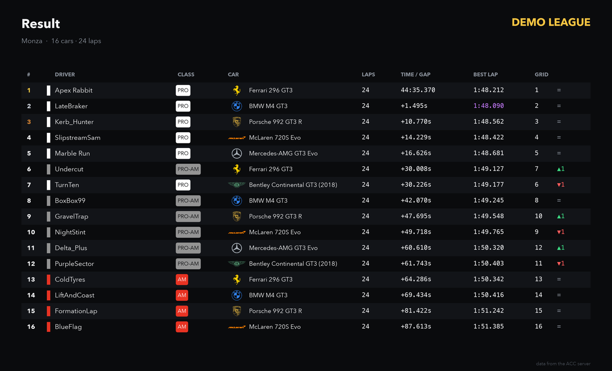
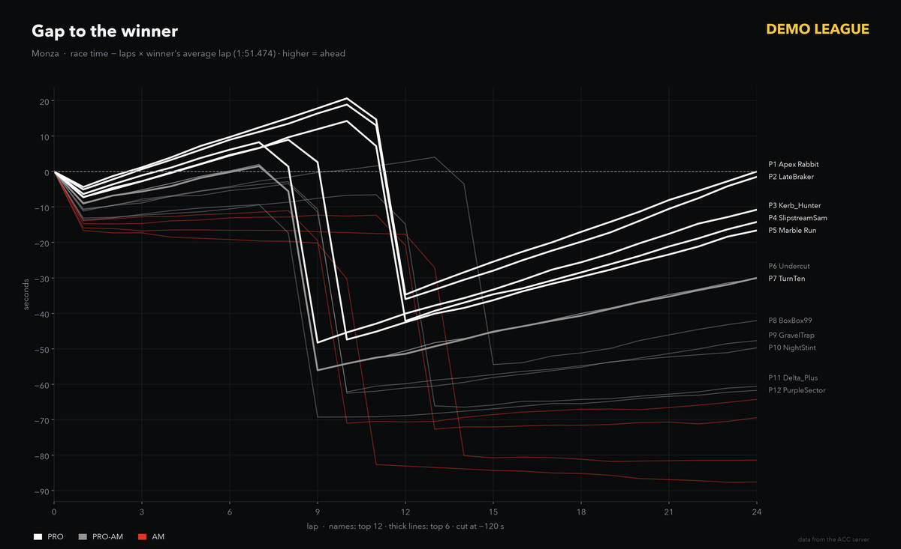
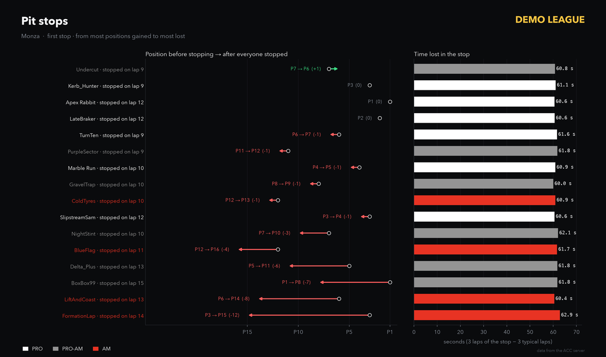
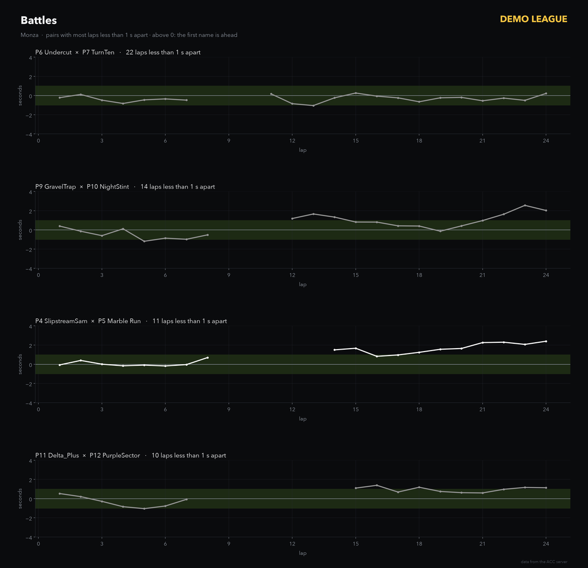

# ACC Race Stats

### [English version →](README.en.md)

**Gráficos de corrida para ligas de Assetto Corsa Competizione, direto do seu servidor.** Escolha um evento numa lista e
receba até 16 gráficos e um resumo para o chat da liga. Windows, macOS e Linux, em português e inglês.

## Passo a passo

Não precisa entender de computador: você clica, digita um número e aperta Enter.

### 1. Baixe

**[⬇ Baixar o ACC Race Stats (zip)](https://github.com/fclesio/acc-race-stats/archive/refs/heads/main.zip)**

### 2. Descompacte

- **Windows:** clique com o botão direito no arquivo baixado → **Extrair tudo…** → **Extrair**.
- **macOS:** clique duas vezes no arquivo baixado (o Safari muitas vezes já descompacta sozinho).
- **Linux:** clique com o botão direito no arquivo baixado → **Extrair aqui**.

Abra sempre o programa da pasta nova, não de dentro do arquivo zip.

### 3. Abra

Na pasta nova, abra o arquivo do seu sistema. Uma janela com texto abre: é nela que o programa faz as perguntas.


Só na primeira vez:

- **Windows** pode perguntar se quer executar um arquivo da internet: clique em **Mais informações → Executar assim
  mesmo**, ou em **Executar**.
- **macOS** pode dizer que o arquivo é de um desenvolvedor não identificado: botão direito em `ACC-Race-Stats.command` →
  **Abrir** → **Abrir**. No macOS 15 ou mais novo: **Ajustes do Sistema → Privacidade e Segurança → Abrir Mesmo
  Assim**.
- Depois o programa baixa sozinho o que precisa, e isso pode levar alguns minutos. Não há nada para instalar.

### 4. Responda as perguntas

Digite a resposta e aperte **Enter**; nas imagens, o que você digita está em amarelo e as dicas em verde. Nos menus,
digite só o número. Endereço, usuário e senha do FTP estão no painel da empresa do seu servidor (o G-Portal, por
exemplo). A senha aparece só como asteriscos.



Escolha o evento, do mais recente para o mais antigo, e o que desenhar:



Categorias, nome da liga e se quer salvar as respostas. Escolha **1** para salvar: da próxima vez ele quase não pergunta
nada.



### 5. Pronto

A pasta com os gráficos abre sozinha. Tudo da sessão está nela: os gráficos, o `summary.txt` para colar no chat da liga e
o `race.json` com os dados. Todos os resultados ficam em **Documentos → ACC Race Stats**.



### Da próxima vez

Abra o mesmo arquivo de novo. Com as respostas salvas, ele conecta sozinho e só pergunta qual evento desenhar:



Para mudar as respostas salvas, abra o `acc-race-stats.toml` da pasta do programa em qualquer editor de texto, ou apague
esse arquivo para responder tudo de novo. Deu algum problema? Veja [problemas comuns](docs/troubleshooting.md) (em
inglês).

## Os gráficos



| | |
|---|---|
|  |  |
|  |  |

As imagens vêm de uma corrida inventada (`./run.sh demo`). Veja [cada gráfico explicado](docs/charts.md) (em inglês).

## Pelo terminal

[](pyproject.toml)
[](LICENSE)
[](https://www.conventionalcommits.org/en/v1.0.0/)

Os arquivos de clique duplo chamam o `run.sh` (macOS, Linux) ou o `make.bat` (Windows). Eles só precisam de `sh` e `curl`
(ou `wget`), ou do PowerShell no Windows: sem `make`, Python ou ferramentas de desenvolvedor. A primeira vez instala o
[uv](https://docs.astral.sh/uv/), o Python e as bibliotecas, sem mexer no perfil do shell nem no `PATH`.

| Comando | O que faz |
|---|---|
| `./run.sh` ou `make` (Windows: `make` ou `.\make`) | pergunta o idioma (português é o padrão) e depois todo o resto |
| `./run.sh pt-br` / `./run.sh en` | o mesmo, em português / inglês (`make pt-br`, `make en`) |
| `./run.sh demo` | um fim de semana de corrida inventado, sem servidor (`make demo`) |
| `./run.sh --league "Minha Liga" …` | qualquer [opção](docs/usage.md) (`make ARGS='…'`) |

## Arquivo de configuração

Na primeira vez, o programa oferece salvar as respostas em `acc-race-stats.toml`, na pasta do projeto; não é preciso
escrever nada à mão. Para mudar, abra esse arquivo em qualquer editor de texto, ou apague para responder tudo de novo.
Ele também pode ser escrito a partir de [`acc-race-stats.example.toml`](acc-race-stats.example.toml). Toda linha é
opcional: o que está no arquivo não é perguntado, e opções digitadas na linha de comando têm prioridade.

```toml
[server]
address = "203.0.113.10:8821"
user = "meuusuario"
password = "minha-senha-do-ftp"

[report]
language = "pt-br"
league = "Minha Liga"
divisions = "pro"
```

O arquivo guarda a senha do FTP em texto puro: não compartilhe. No macOS e no Linux, o programa deixa ele legível só pelo
seu usuário, e ele está no `.gitignore`. Se a senha mudar no servidor, o programa pede a nova e atualiza o arquivo. Sem
`password`, a senha é perguntada toda vez. Veja [todas as configurações](docs/usage.md#settings-file) (em inglês).

## Recursos

- **Feito para quem organiza ligas.** Atalho de clique duplo, menus numerados, servidor lembrado, arquivo de
  configuração opcional e erros claros: ele diz se o servidor não respondeu ou se a senha está errada.
- **Eventos, não arquivos.** Uma corrida aparece junto com a classificação e o treino; o grid vem da classificação.
- **Categorias do seu jeito.** Pro/Pro-Am/Am, Ouro/Prata/Bronze, divisões, nomes próprios ou uma cor por piloto.
- **Relógio de corrida correto.** Posições e diferenças incluem o tempo da luz verde até a linha, e primeiras voltas
  impossíveis são reconstruídas. Veja [como funciona](docs/race-clock.md).
- **Rápido em servidores lentos.** Lê só os arquivos necessários e guarda o que já baixou.
- **Privado.** A senha só fica guardada se você escrever no arquivo de configuração, e os ids dos jogadores nunca vão
  para os resultados.

## Documentação

A documentação detalhada está em inglês.

| Página | |
|---|---|
| [Uso](docs/usage.md) | todas as opções, lista de pilotos, grid de largada, categorias |
| [Gráficos](docs/charts.md) | o que cada gráfico mostra e como é calculado |
| [Relógio de corrida](docs/race-clock.md) | por que somar os tempos de volta está errado, e a correção |
| [race.json](docs/race-json.md) | formato dos dados |
| [Arquitetura](docs/architecture.md) | módulos e decisões de projeto |
| [Problemas comuns](docs/troubleshooting.md) | o que fazer quando algo dá errado |
| [Como contribuir](CONTRIBUTING.md) | desenvolvimento, commits e versões |
| [Changelog](CHANGELOG.md) | o que mudou em cada versão |

## Situação

A versão atual é a 0.1.1; veja o [changelog](CHANGELOG.md). Foi desenvolvido e testado no macOS; o CI roda os mesmos
testes e atalhos no Windows e no Linux. Problemas nesses sistemas são os relatos mais bem-vindos.

## Licença

[MIT](LICENSE). Os logos das marcas vêm do [Simple Icons](https://simpleicons.org); veja o [NOTICE](NOTICE.md). Este
projeto não tem ligação com a Kunos Simulazioni, com as empresas de servidores nem com as marcas dos carros.
