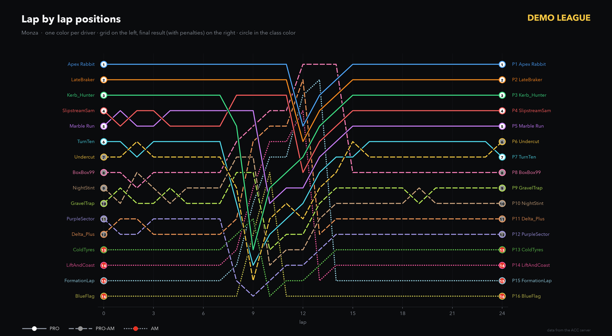
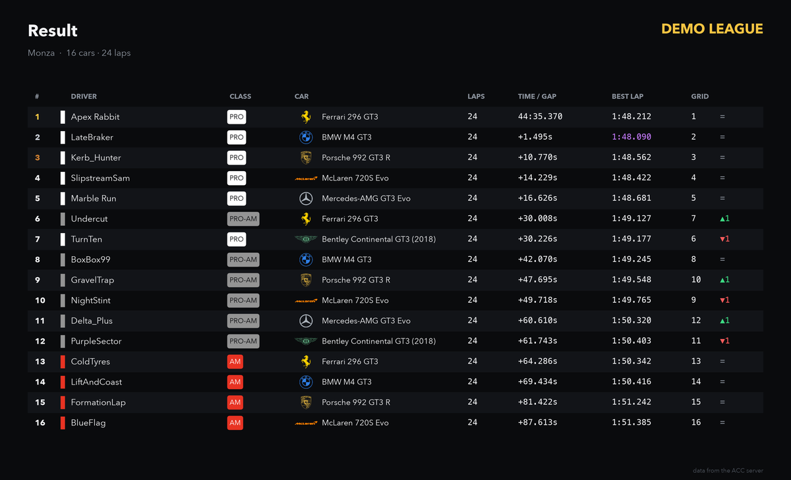
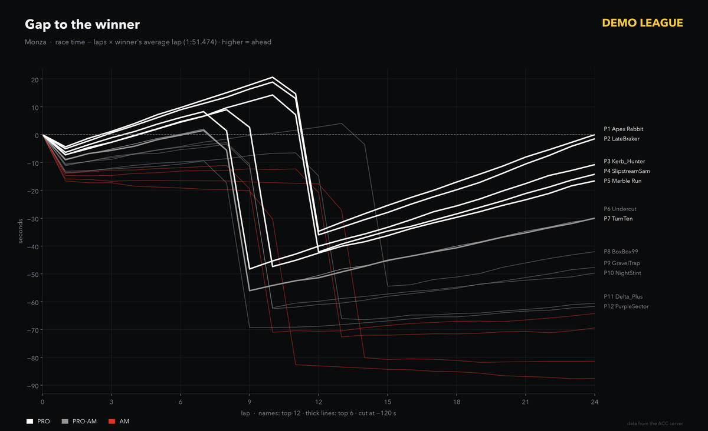
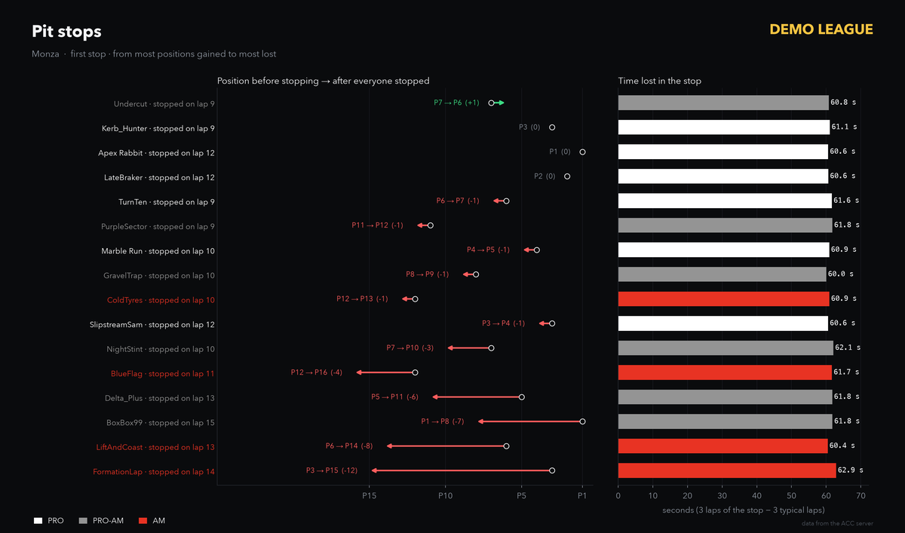
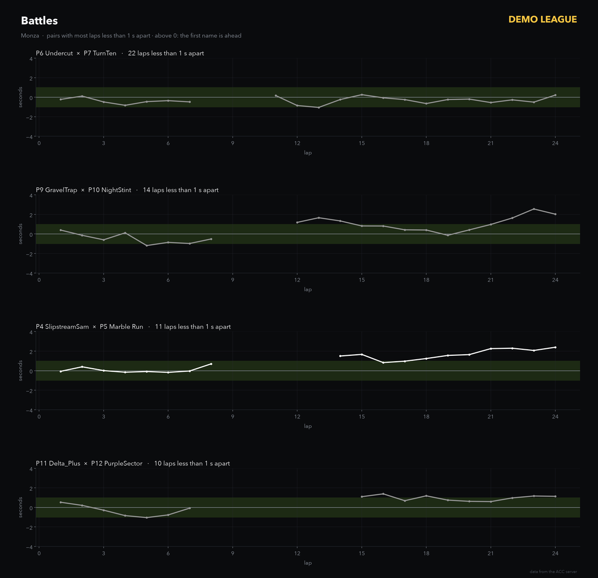

# ACC Race Stats

[English](README.md) · Português (Brasil)

[](pyproject.toml)
[](LICENSE)
[](https://www.conventionalcommits.org/en/v1.0.0/)

**Gráficos de corrida para ligas de Assetto Corsa Competizione, direto do seu servidor.**

Conecte por FTP, escolha um evento numa lista e receba até 16 gráficos e um resumo para o chat da liga. Sem mods, sem
telemetria, sem arquivos para copiar. Funciona no Windows, macOS e Linux, em português e inglês.



| | |
|---|---|
|  |  |
|  |  |

As imagens vêm da corrida inventada do modo demo. Veja [cada gráfico explicado](docs/charts.md) (em inglês).

## Começo rápido

1. [Baixe este projeto](https://github.com/fclesio/acc-race-stats/archive/refs/heads/main.zip) e descompacte.
2. Clique duas vezes no atalho do seu sistema. Uma janela de terminal abre e pergunta tudo passo a passo.

| Sistema | Clique duas vezes | Ou, num terminal na pasta do projeto |
|---|---|---|
| Windows | `ACC-Race-Stats.bat` | `make` (Prompt de Comando) ou `.\make` (PowerShell) |
| macOS | `ACC-Race-Stats.command` | `./run.sh` ou `make` |
| Linux | veja abaixo | `./run.sh` ou `make` |

A primeira vez baixa sozinha o que é preciso ([uv](https://docs.astral.sh/uv/), Python e as bibliotecas), só uma vez, e
pode levar alguns minutos. Não é preciso instalar nem digitar nada: o `run.sh` só precisa de `sh` e `curl` (ou `wget`),
então funciona sem `make` e em versões mais antigas do macOS.

- **Windows:** se o Windows perguntar se quer executar um arquivo da internet, escolha **Executar** (ou **Mais
  informações → Executar assim mesmo**).

- **macOS:** na primeira vez, o macOS pode dizer que o arquivo é de um desenvolvedor não identificado. Clique com o botão
  direito em `ACC-Race-Stats.command` e escolha **Abrir** (no macOS 15 ou mais novo: **Ajustes do Sistema →
  Privacidade e Segurança → Abrir Mesmo Assim**). Nas próximas vezes, o clique duplo basta.
- **Linux:** na primeira vez, clique com o botão direito em `run.sh` e escolha **Executar como um programa**. Depois
  disso, o **ACC Race Stats** aparece no menu de aplicativos.
- Abra o atalho da pasta descompactada, não de dentro do arquivo zip.

| Comando | O que faz |
|---|---|
| `./run.sh` ou `make` | pergunta o idioma (português é o padrão) e depois todo o resto |
| `./run.sh pt-br` / `./run.sh en` | o mesmo, em português / inglês (`make pt-br`, `make en`) |
| `./run.sh demo` | um fim de semana de corrida inventado, sem servidor (`make demo`) |

No fim das perguntas, ele oferece salvar as respostas (servidor, senha, liga, categorias), e da próxima vez só pergunta
qual evento desenhar. Veja [arquivo de configuração](#arquivo-de-configuração).

## Como fica

```text
Idioma / Language
  1  Português (Brasil)
  2  English
Número (aperte Enter para 1): 1

1. Conexão (copie do painel do seu servidor, por exemplo o G-Portal)
Endereço do FTP (IP ou IP:porta): 203.0.113.10:8821
Usuário do FTP: meuusuario
Senha do FTP: ********
Conectando...
Conectado.

2. Escolha uma (a mais recente primeiro)
   1  15/03/2026 21:40   Monza              26 carros   Corrida + Classificação + Treino
   2  08/03/2026 21:34   Spa-Francorchamps  18 carros   Corrida + Classificação
   3  07/03/2026 20:10   Monza              12 carros   Treino
Digite o número (aperte Enter para 1): 1

O que você quer ver?
  1  Corrida
  2  Classificação
  3  Treino
  4  Todas
Número (aperte Enter para 1): 1

3. Categorias
Categorias salvas no arquivo: PRO (10), SILVER (9), AM (7)

Sua liga usa categorias?
  1  Sim
  2  Não, uma cor por piloto
Número (aperte Enter para 1): 1

4. Gráficos
Nome da liga em destaque (vazio = nenhum): Minha Liga
```

A pasta com os resultados abre no final. Eles ficam em `ACC Race Stats`, na sua pasta Documentos, com uma pasta por
sessão. Tudo de uma sessão fica nessa mesma pasta:

| Arquivo | Conteúdo |
|---|---|
| `01-result.png` … `16-pace-distribution.png` | os gráficos |
| `summary.txt` | texto para colar no chat da liga |
| `race.json` | a análise em dados, com as batalhas ([formato](docs/race-json.md)) |

## Arquivo de configuração

Na primeira vez, o programa oferece salvar as respostas em `acc-race-stats.toml`, na pasta do projeto; não é preciso
escrever nada à mão. Para mudar, abra esse arquivo em qualquer editor de texto, ou apague para responder tudo de novo.
Ele também pode ser escrito a partir de [`acc-race-stats.example.toml`](acc-race-stats.example.toml). Toda linha é
opcional: o que está no arquivo não é perguntado, e opções digitadas na linha de comando têm prioridade.

```toml
[server]
address = "203.0.113.10:8821"
user = "meuusuario"
password = "minha-senha-do-ftp"

[report]
language = "pt-br"
league = "Minha Liga"
divisions = "pro"
```

O arquivo guarda a senha do FTP em texto puro: não compartilhe. No macOS e no Linux, o programa deixa ele legível só pelo
seu usuário, e ele está no `.gitignore`. Se a senha mudar no servidor, o programa pede a nova e atualiza o arquivo. Sem
`password`, a senha é perguntada toda vez. Veja [todas as configurações](docs/usage.md#settings-file) (em inglês).

## Recursos

- **Feito para quem organiza ligas.** Atalho de clique duplo, menus numerados, servidor lembrado, arquivo de
  configuração opcional e erros claros: ele diz se o servidor não respondeu ou se a senha está errada.
- **Eventos, não arquivos.** Uma corrida aparece junto com a classificação e o treino; o grid vem da classificação.
- **Categorias do seu jeito.** Pro/Pro-Am/Am, Ouro/Prata/Bronze, divisões, nomes próprios ou uma cor por piloto.
- **Relógio de corrida correto.** Posições e diferenças incluem o tempo da luz verde até a linha, e primeiras voltas
  impossíveis são reconstruídas. Veja [como funciona](docs/race-clock.md).
- **Rápido em servidores lentos.** Lê só os arquivos necessários e guarda o que já baixou.
- **Privado.** A senha só fica guardada se você escrever no arquivo de configuração, e os ids dos jogadores nunca vão
  para os resultados.

## Documentação

A documentação detalhada está em inglês.

| Página | |
|---|---|
| [Uso](docs/usage.md) | todas as opções, lista de pilotos, grid de largada, categorias |
| [Gráficos](docs/charts.md) | o que cada gráfico mostra e como é calculado |
| [Relógio de corrida](docs/race-clock.md) | por que somar os tempos de volta está errado, e a correção |
| [race.json](docs/race-json.md) | formato dos dados |
| [Arquitetura](docs/architecture.md) | módulos e decisões de projeto |
| [Problemas comuns](docs/troubleshooting.md) | o que fazer quando algo dá errado |
| [Como contribuir](CONTRIBUTING.md) | desenvolvimento, commits e versões |
| [Changelog](CHANGELOG.md) | o que mudou em cada versão |

## Situação

A versão atual é a 0.1.1; veja o [changelog](CHANGELOG.md). Foi desenvolvido e testado no macOS; o CI roda os mesmos
testes e atalhos no Windows e no Linux. Problemas nesses sistemas são os relatos mais bem-vindos.

## Licença

[MIT](LICENSE). Os logos das marcas vêm do [Simple Icons](https://simpleicons.org); veja o [NOTICE](NOTICE.md). Este
projeto não tem ligação com a Kunos Simulazioni, com as empresas de servidores nem com as marcas dos carros.
