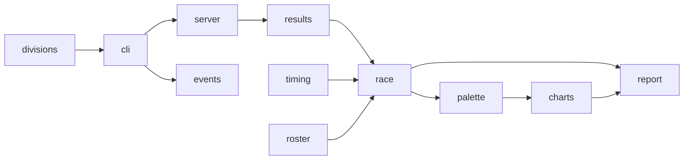

# Architecture

| Module | Responsibility |
|---|---|
| `cli` | questions, options and the order of the steps |
| `terminal` | reads keys one by one; masked password |
| `messages`, `i18n` | text of the questions, and of the charts |
| `server` | FTP: finds, downloads and caches result files |
| `results` | reads ACC files (UTF-16 or UTF-8) and their names |
| `events` | groups files into a race with its qualifying and practice |
| `timing` | [race clock](race-clock.md) |
| `race` | the analysis; every chart and report reads this model |
| `divisions`, `palette`, `roster` | categories, colors, driver list and grid |
| `charts`, `report` | PNG files, `summary.txt` and `race.json` |
| `folders`, `settings` | where things are saved on each system |
| `gamedata` | cars, tracks and categories of the game |
| `demo` | invented race weekend, also used by the tests |

## Decisions

- **One model, many outputs.** Charts and text never read the game files; they read `Race`. `race.json` is the same model
  for other programs.
- **FTP first.** The people who run leagues should not move files. A path is accepted for scripts and tests.
- **Own key reader.** `input()` depends on how the previous program left the terminal, and Enter may never arrive.
  Reading keys directly handles carriage returns, the numeric keypad and extended keyboard modes.
- **Few round trips.** On a distant server each file takes more than a second. Small files are skipped by size, the
  biggest practice is taken as the main one, and downloads are cached because result files never change.
- **No decision by color alone** where lines cross: dashes, markers or labels repeat it.
- **One runtime dependency**, matplotlib.

## Tests

`pytest` runs against the invented weekend and an FTP server inside the test process, which can refuse passwords and
drop connections. Other tests check that every text is translated and that all logos have the same size.
