# Charts

**Clean laps** leave out lap 1, the stop lap and the laps before and after it, and laps slower than 107% of the driver's
median. **Pit stops** are laps more than 25 s (and 7%) slower than the driver's median. Stops to serve a penalty are not
counted as pit stops.

## Race

| Chart | What it shows |
|---|---|
| `01-result` | final order, category, car, laps, gap, best lap (fastest in purple) and grid |
| `02-positions-gained` | grid position − final position |
| `03-race-start` | grid position − position at the end of lap 1 |
| `04-gap-to-winner` | race time against the average lap of the winner; higher is ahead |
| `05-stints` | laps between stops, and penalties served |
| `06-top5-pace` | clean laps of the top 5 |
| `07-pace-by-class` | top 3 of each category, 3-lap moving average of clean laps |
| `08-battles` | pairs with most laps less than 1 s apart, without the laps around their stops |
| `09-pit-stops` | position 2 laps before the first stop and after everyone stopped, and the time lost |
| `10-consistency` | average distance of the clean laps to the driver's median |
| `11-best-lap` | gap to the fastest lap |
| `12-lap-by-lap` | position at the line in every lap; the last point is the final result, with penalties |
| `13-ideal-lap` | sum of the best sectors in valid laps |
| `14-invalid-laps` | invalid laps, without lap 1 and the laps around the stops |
| `15-sectors` | best time of each sector in valid laps |
| `16-pace-distribution` | box plot of the clean laps: middle half, median, and whiskers up to 1.5 × the box |

Charts without data are not drawn: `02` and `03` need a grid, `07` needs more than one category, and `08` needs a battle.

Notes:

- **Retired** means less than 75% of the laps of the winner.
- **Time lost in a stop** is the stop lap and its two neighbours − 3 × the driver's median.
- **After everyone stopped** is 2 laps after 80% of the drivers made their first stop.

## Qualifying and practice

| Chart | Qualifying | Practice |
|---|---|---|
| `01-result` | ✓ | ✓ |
| `02-laps` | | ✓ |
| `10-consistency` | | ✓ |
| `11-best-lap` | ✓ | ✓ |
| `13-ideal-lap` | ✓ | ✓ |
| `14-invalid-laps` | ✓ | ✓ |
| `15-sectors` | ✓ | ✓ |
| `16-pace-distribution` | | ✓ |

## Gallery

| | |
|---|---|
| 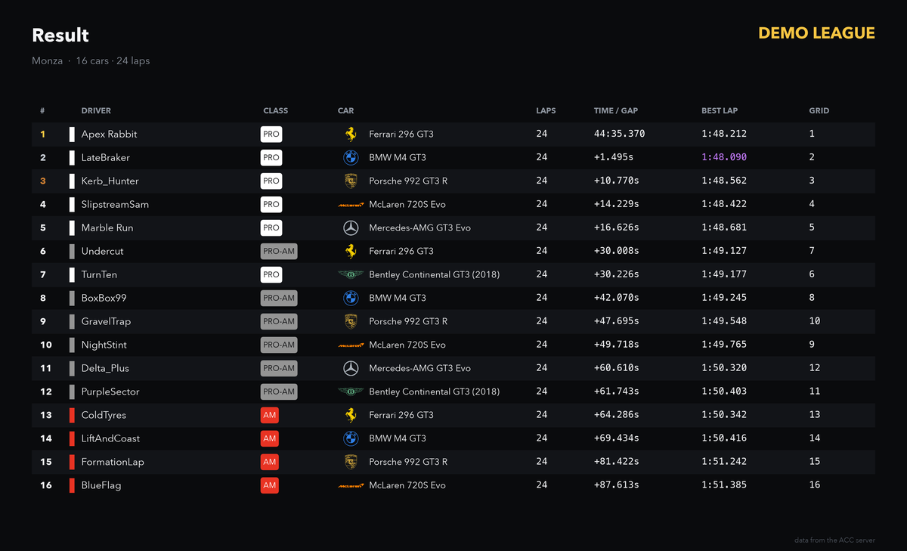 | 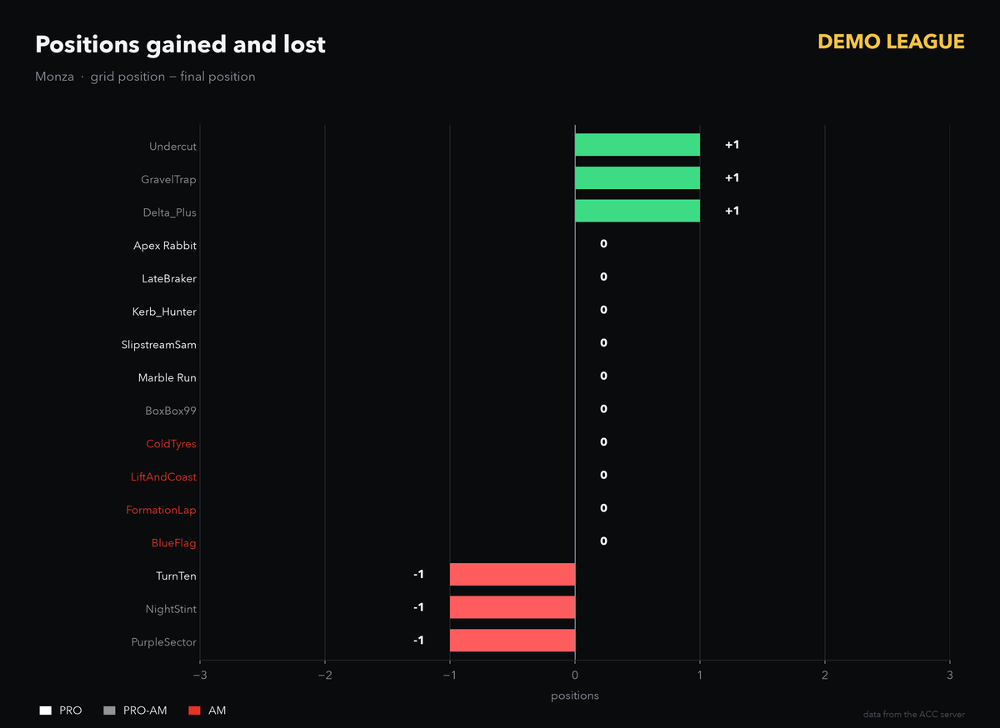 |
| 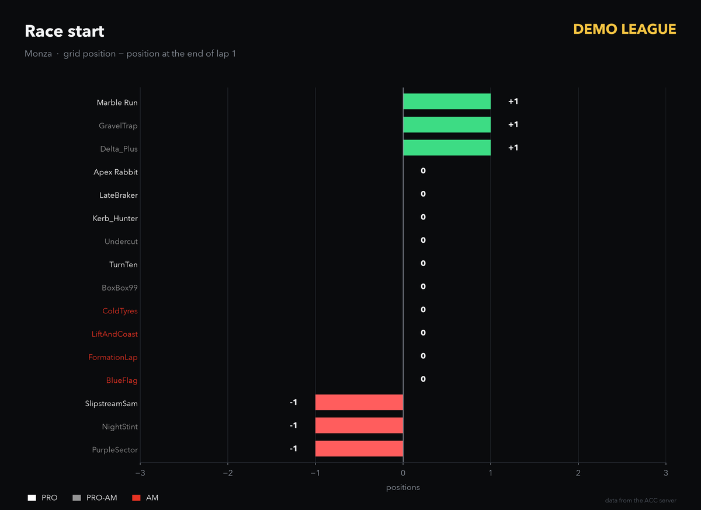 | 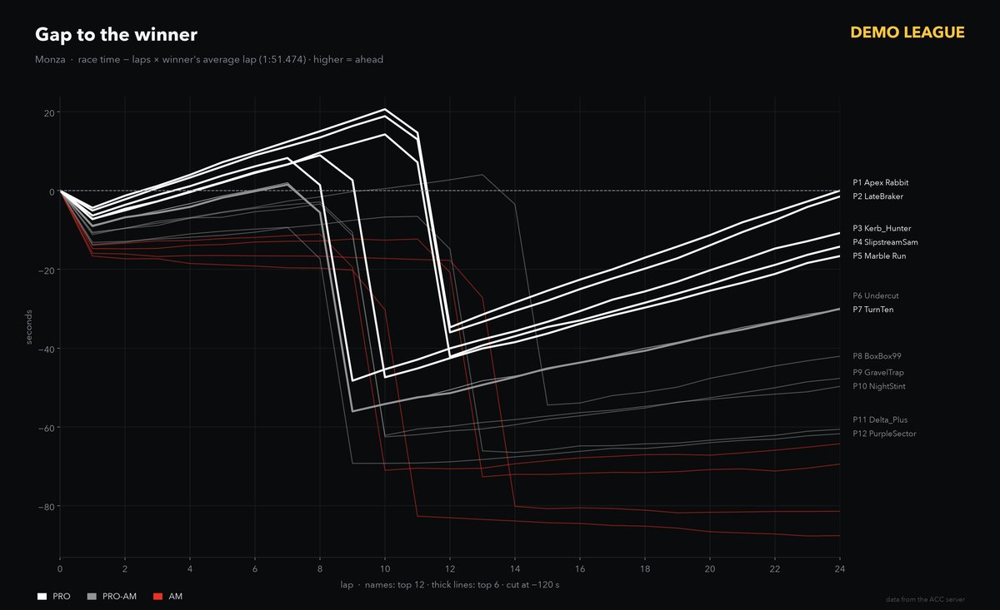 |
| 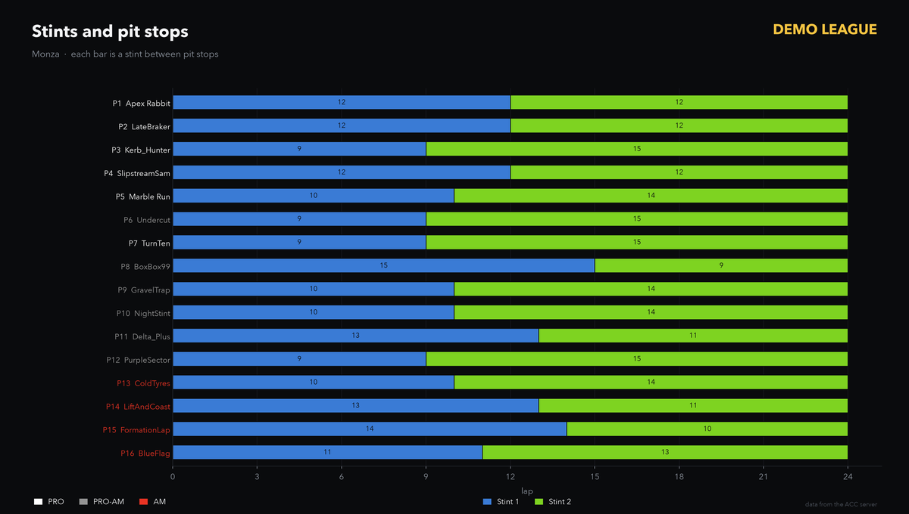 | 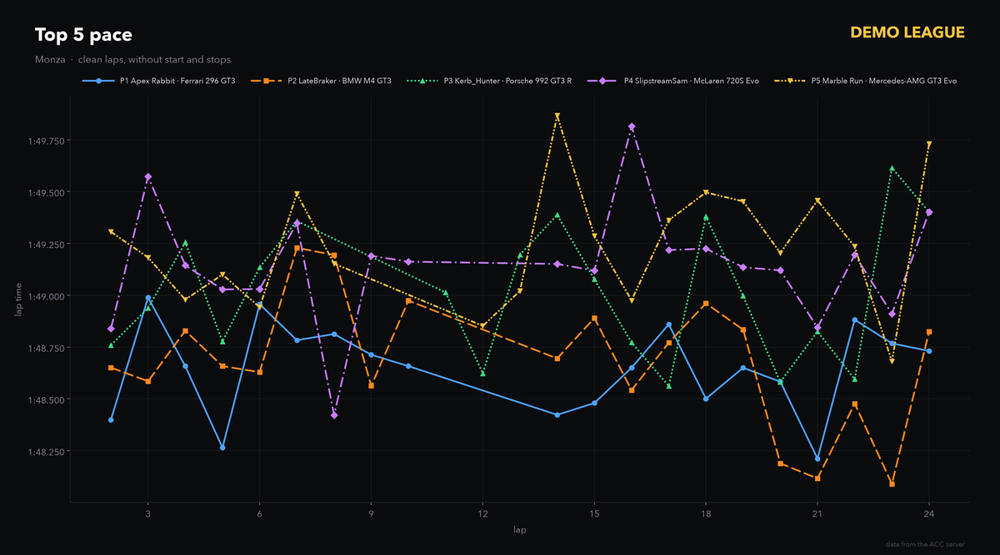 |
| 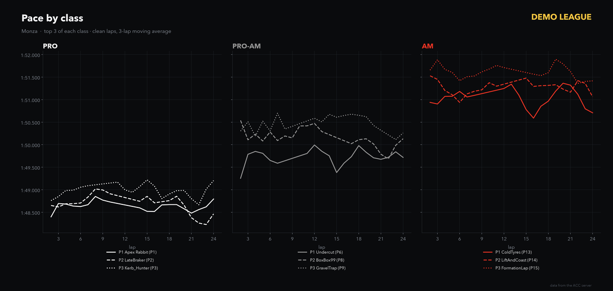 | 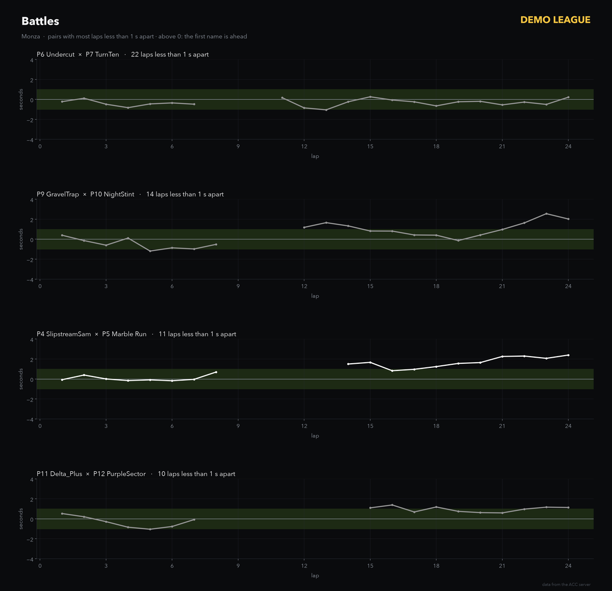 |
| 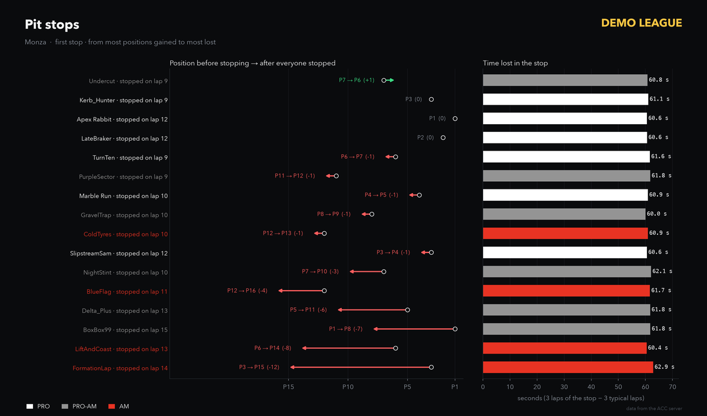 | 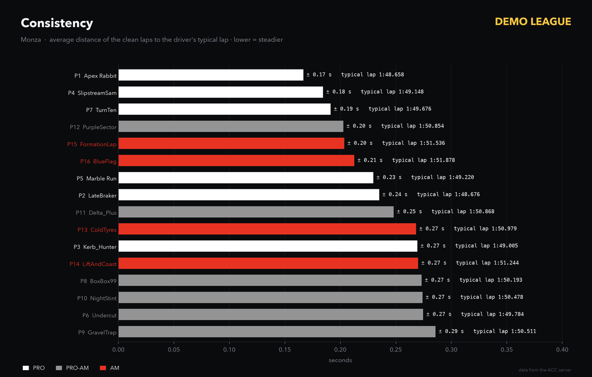 |
|  | 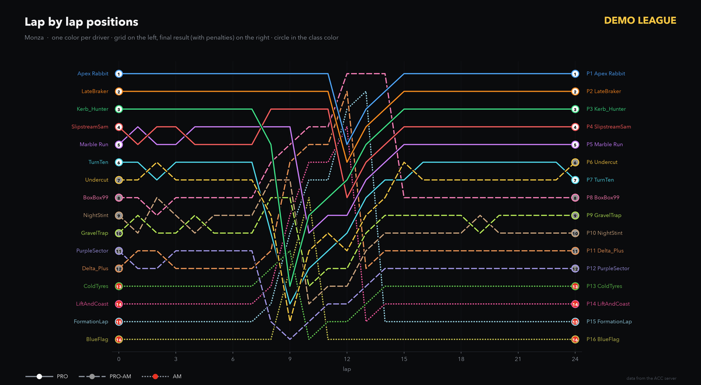 |
| 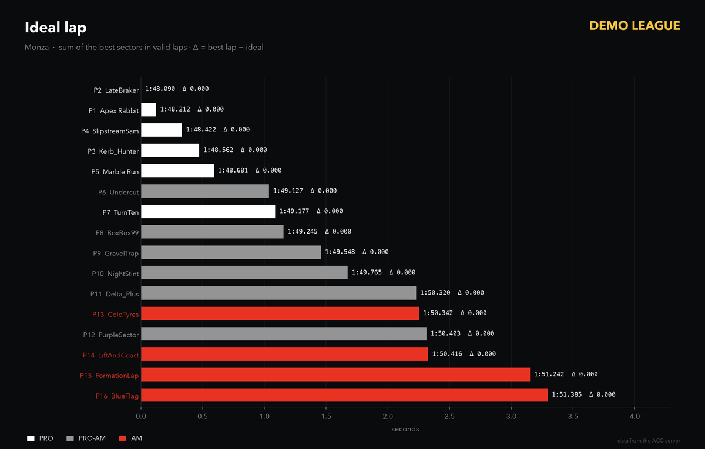 | 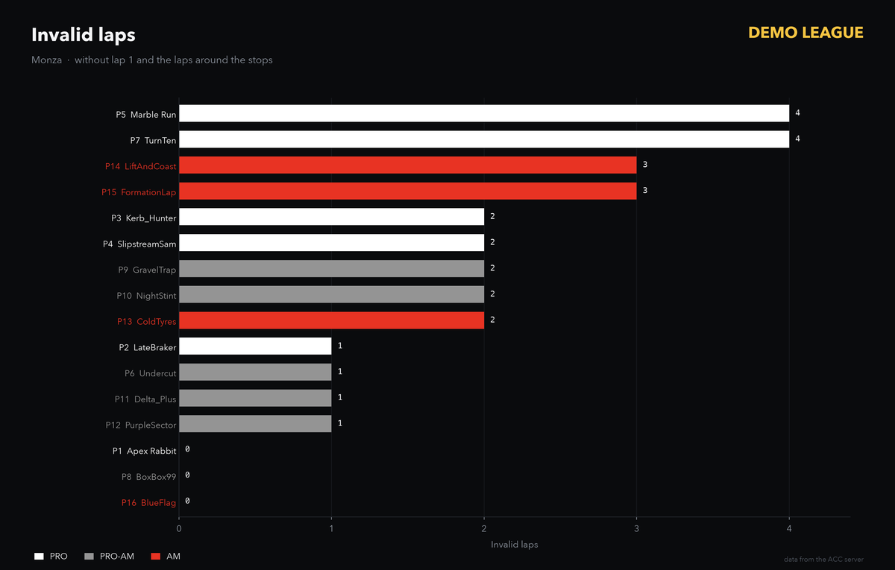 |
| 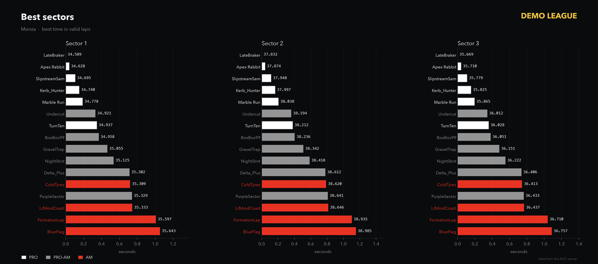 | 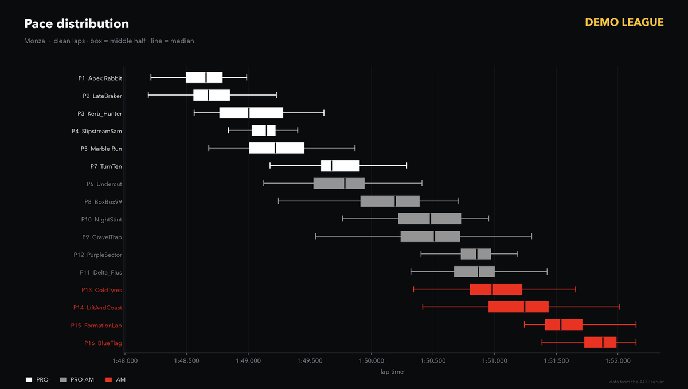 |

One color per driver (`--divisions none`):

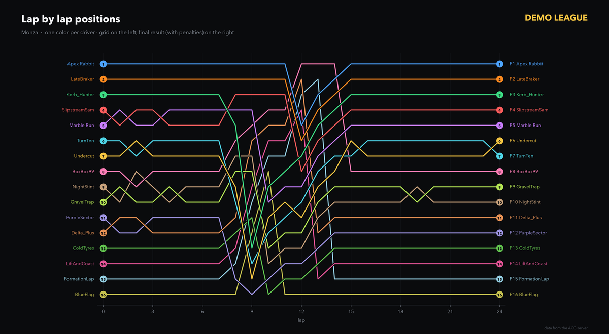
