# Como ler os gráficos: o exemplo do Rico Nosberg

[← Voltar para o início](../README.md)

**VRT APEX II · Monza** · 26 carros, 30 voltas

Neste exemplo, vamos usar o **Rico Nosberg**, vencedor de uma corrida da VRT APEX II em Monza, e acompanhar a corrida
dele para ver como ler cada gráfico. Para cada um, primeiro o que procurar (**Como ler**) e depois o que o gráfico
mostra sobre a corrida dele (**No exemplo do Rico Nosberg**). O mesmo jeito de ler vale para qualquer piloto da sua
liga.

Todos os pilotos têm nomes fictícios: nomes de pilotos de F1 com as iniciais trocadas. As imagens estão em alta
resolução: clique numa delas para abrir no tamanho original.

Definições usadas em vários gráficos:

- **Voltas limpas**: sem a volta 1, sem a volta da parada e as voltas antes e depois dela, e sem voltas mais de 7% mais
  lentas que a mediana do piloto.
- **Parada no box**: volta mais de 25 s (e 7%) mais lenta que a mediana do piloto. Paradas para cumprir punição não
  contam.
- **Abandono**: menos de 75% das voltas do vencedor.

O grid de largada veio da tela de classificação do jogo, passado ao programa com `--grid` (veja
[grid de largada](usage.md#starting-grid)). Com o arquivo da classificação na mesma pasta da corrida, isso é
automático.

## A corrida do Rico Nosberg em resumo

O Rico Nosberg (BMW M4 GT3) largou em 3º, fechou a primeira volta em 2º, atrás do Hewis Lamilton, assumiu a liderança na
volta 7 e só a deixou durante as paradas. O pole, Rimi Kaikkonen, terminou em 6º. Venceu por 4,761 s sobre o Hika
Makkinen, que fez a volta mais rápida da corrida. Ganhou com três coisas:

1. **Ritmo.** Teve o melhor ritmo típico da corrida (1:48.517), à frente até do Hika Makkinen (1:48.572).
2. **Regularidade.** Foi o piloto mais constante da corrida (± 0,23 s) e o único a terminar sem nenhuma volta
   invalidada.
3. **Controle.** Parou na mesma volta que o Hika Makkinen (a 18), perdeu praticamente o mesmo tempo no box e voltou à
   liderança na volta 20. A vantagem, que era de 0,7 s na volta 1, passou de 5 s no fim.

## Resultado

`01-result.png`

[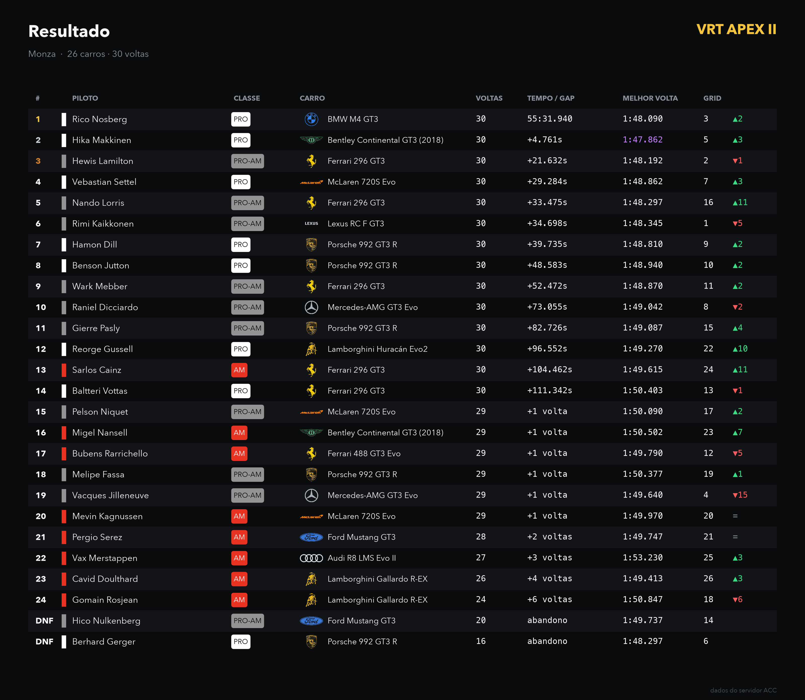](images/graficos/01-result.png)

**Como ler.** Uma linha por piloto, na ordem final. Em **TEMPO / GAP**, o vencedor tem o tempo total e os outros, a
diferença para ele; quem terminou com menos voltas aparece como "+1 volta", e quem não completou 75% da corrida, como
"abandono" (DNF). A melhor volta da corrida aparece em roxo. Ao lado da posição no GRID, a seta mostra quantas posições
o piloto ganhou (▲ verde) ou perdeu (▼ vermelho) até a bandeirada; = é a mesma posição.

**No exemplo do Rico Nosberg.** Largou em 3º e venceu em 30 voltas, com 55:31.940, 4,761 s à frente do Hika Makkinen e
21,6 s à frente do Hewis Lamilton, 3º e vencedor da PRO-AM. A melhor volta dele (1:48.090) foi a segunda mais rápida; a
mais rápida, em roxo, foi a do Hika Makkinen (1:47.862). Os 14 primeiros completaram as 30 voltas.

## Posições ganhas e perdidas

`02-positions-gained.png`

[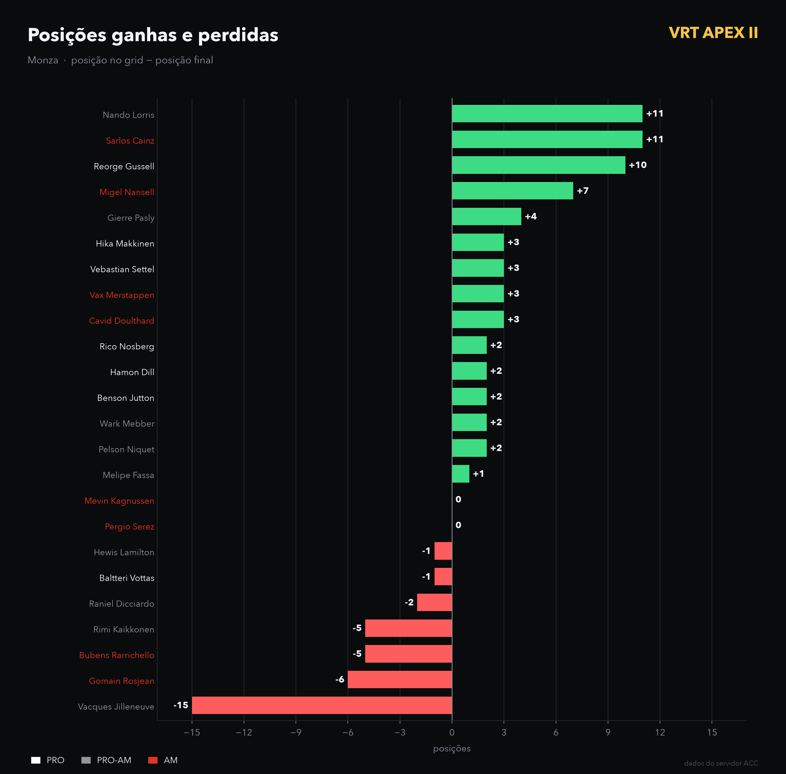](images/graficos/02-positions-gained.png)

**Como ler.** Posição no grid menos posição final: verde à direita ganhou posições, vermelho à esquerda perdeu. É o
saldo da corrida inteira (largada, ritmo, paradas e punições juntos). Quem abandonou não aparece.

**No exemplo do Rico Nosberg.** **+2**: largou em 3º e venceu. As maiores escaladas foram do Sarlos Cainz e do Nando
Lorris (+11 cada) e do Reorge Gussell (+10); a maior queda, do Vacques Jilleneuve (−15).

## Largada

`03-race-start.png`

[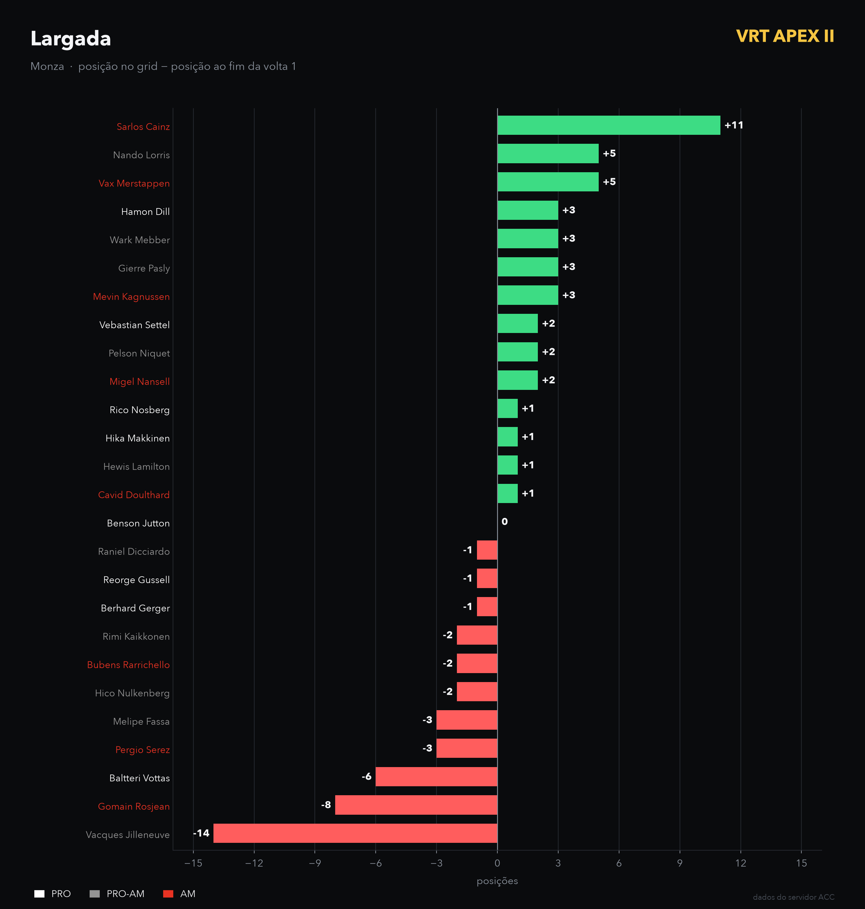](images/graficos/03-race-start.png)

**Como ler.** O mesmo cálculo, mas só para a primeira volta: posição no grid menos posição ao fim da volta 1. Barras
grandes dos dois lados indicam uma largada movimentada, com toques ou erros.

**No exemplo do Rico Nosberg.** **+1**: passou o pole, Rimi Kaikkonen, e fechou a volta 1 em 2º, atrás do Hewis
Lamilton. Uma largada sem risco: o ganho grande dele veio depois, na pista. Na volta 1, o Sarlos Cainz ganhou 11
posições, e o Vacques Jilleneuve perdeu 14.

## Diferença para o vencedor

`04-gap-to-winner.png`

[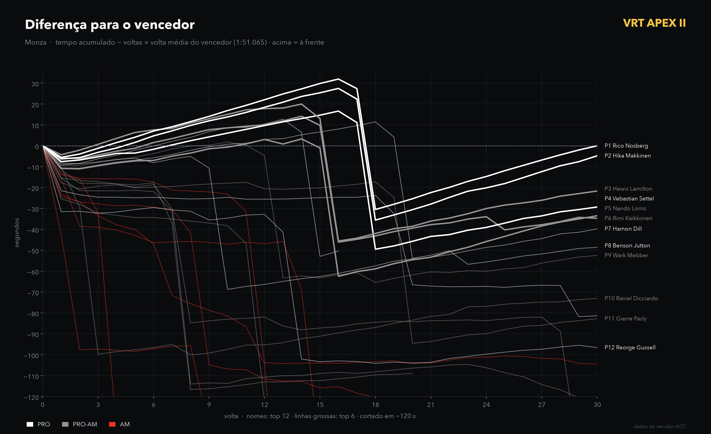](images/graficos/04-gap-to-winner.png)

**Como ler.** A linha tracejada no 0 é um piloto imaginário que roda sempre na volta média do vencedor (aqui, 1:51.065,
com a parada incluída). Linha subindo é ritmo melhor que essa média; as quedas bruscas são paradas no box. A distância
vertical entre duas linhas é a diferença entre os dois pilotos.

**No exemplo do Rico Nosberg.** Como ele é o vencedor, a linha dele termina exatamente no 0. É a linha que mais sobe até
a volta 17: ele estava mais rápido que todos antes das paradas. A queda na volta 18 é a parada dele, junto com a do Hika
Makkinen; depois disso, as duas linhas sobem paralelas, e a distância entre elas é a vantagem de cerca de 5 s.

## Stints e paradas

`05-stints.png`

[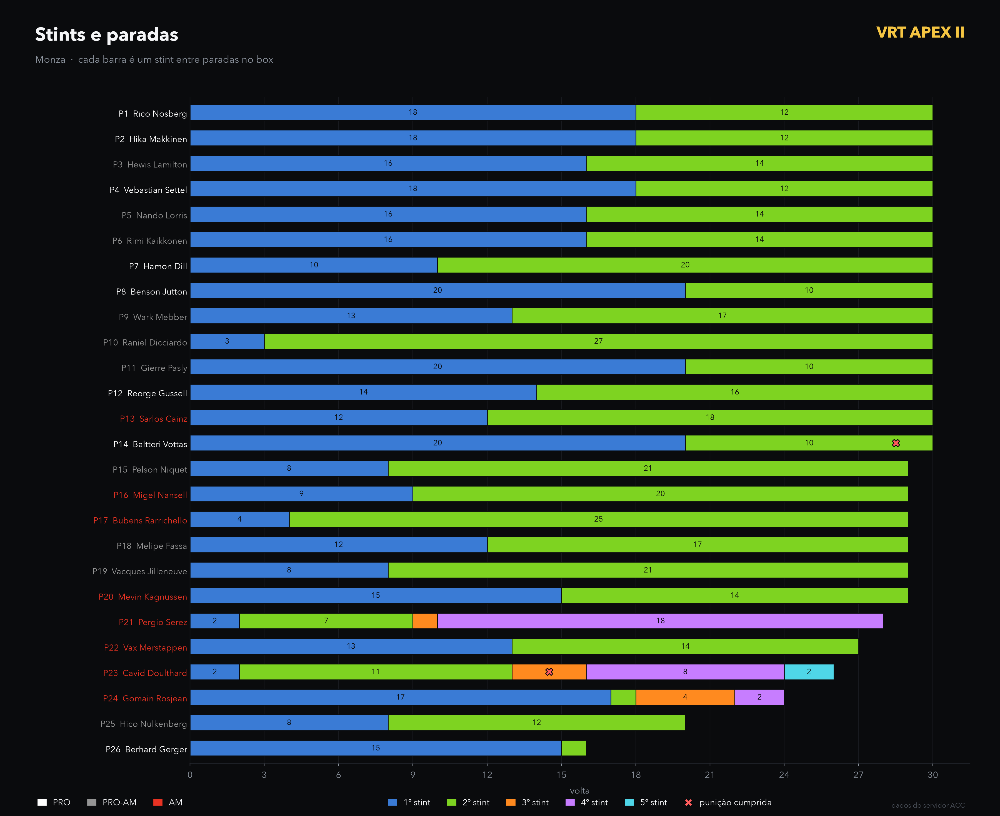](images/graficos/05-stints.png)

**Como ler.** Cada cor é um trecho entre paradas, com o número de voltas escrito dentro. Onde a cor muda, o piloto
parou; o X vermelho marca uma punição cumprida.

**No exemplo do Rico Nosberg.** Uma parada só, na volta 18: **18 voltas + 12 voltas**, a mesma estratégia do Hika
Makkinen e do Vebastian Settel. O Hewis Lamilton e o Nando Lorris pararam antes, na volta 16.

## Ritmo do top 5

`06-top5-pace.png`

[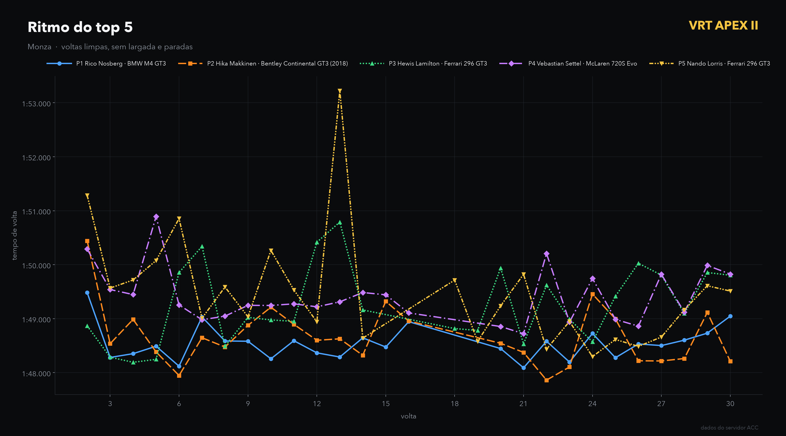](images/graficos/06-top5-pace.png)

**Como ler.** Os tempos das voltas limpas dos cinco primeiros, sem a largada e as voltas das paradas. Mais baixo é mais
rápido; linha reta é ritmo constante, picos são erros, tráfego ou disputa.

**No exemplo do Rico Nosberg.** A linha azul é a dele: quase toda entre 1:48.1 e 1:49.1, sem nenhum pico. O Hika
Makkinen (laranja) teve as voltas mais rápidas, como 1:47.862 na volta 22, mas também voltas acima de 1:49. O Nando
Lorris (amarelo) chegou a 1:53 na volta 13.

## Ritmo por classe

`07-pace-by-class.png`

[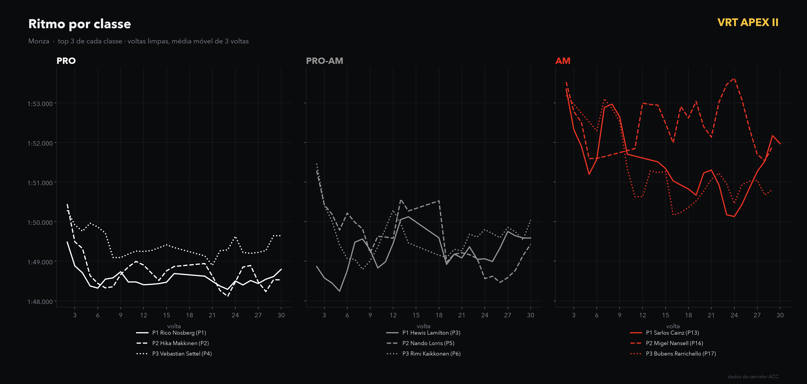](images/graficos/07-pace-by-class.png)

**Como ler.** Um painel por categoria, com a mesma escala de tempo e a média de 3 voltas limpas. Mais baixo é mais
rápido; linha subindo no fim é perda de rendimento.

**No exemplo do Rico Nosberg.** No painel PRO, a linha contínua é a dele, a mais baixa e mais reta durante quase toda a
corrida. O Hika Makkinen (tracejada) só ficou abaixo dele em alguns trechos, nas voltas 6 a 8 e logo depois da volta 21.

## Batalhas

`08-battles.png`

[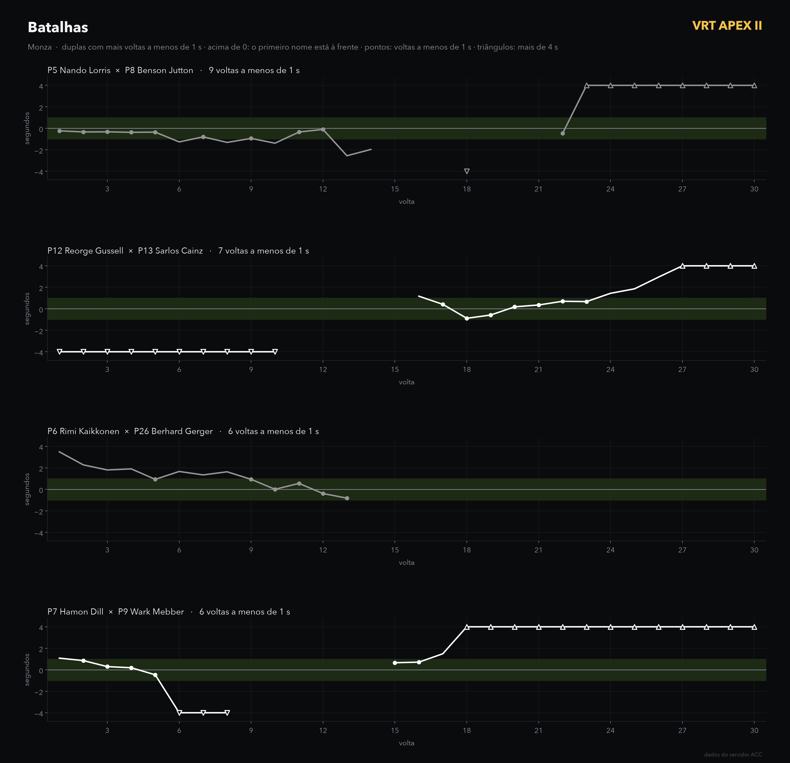](images/graficos/08-battles.png)

**Como ler.** Um painel por dupla de vizinhos que andou junta. A linha é a diferença entre os dois: acima de 0, o
primeiro nome está à frente. A faixa verde é a zona de menos de 1 s, os pontos são as voltas de disputa e os triângulos,
diferenças de mais de 4 s.

**No exemplo do Rico Nosberg.** Ele **não aparece**: nunca ficou 3 voltas a menos de 1 s de outro carro. A maior disputa
da corrida foi no meio do pelotão, entre Nando Lorris e Benson Jutton, com 9 voltas a menos de 1 s.

## Paradas no box

`09-pit-stops.png`

[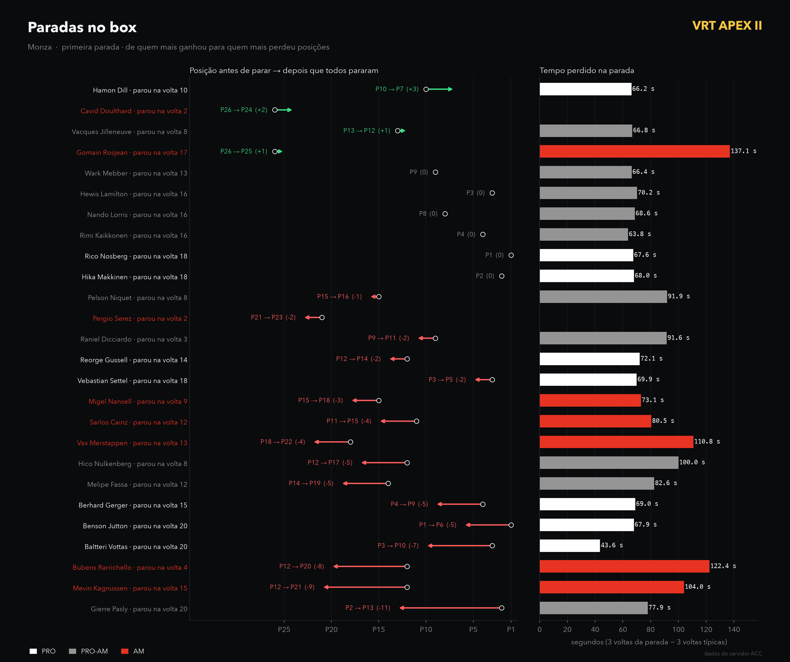](images/graficos/09-pit-stops.png)

**Como ler.** À esquerda, a seta vai da posição 2 voltas antes da primeira parada até a posição depois que todos
pararam: verde ganhou, vermelho perdeu. À direita, o tempo perdido nas 3 voltas em torno da parada, comparado com 3
voltas normais.

**No exemplo do Rico Nosberg.** Estava em 1º antes de parar e continuava em 1º depois que todos pararam, perdendo **67,6
s**, quase o mesmo que o Hika Makkinen (68,0 s). Com paradas iguais, a corrida foi decidida pelo ritmo na pista.

## Consistência

`10-consistency.png`

[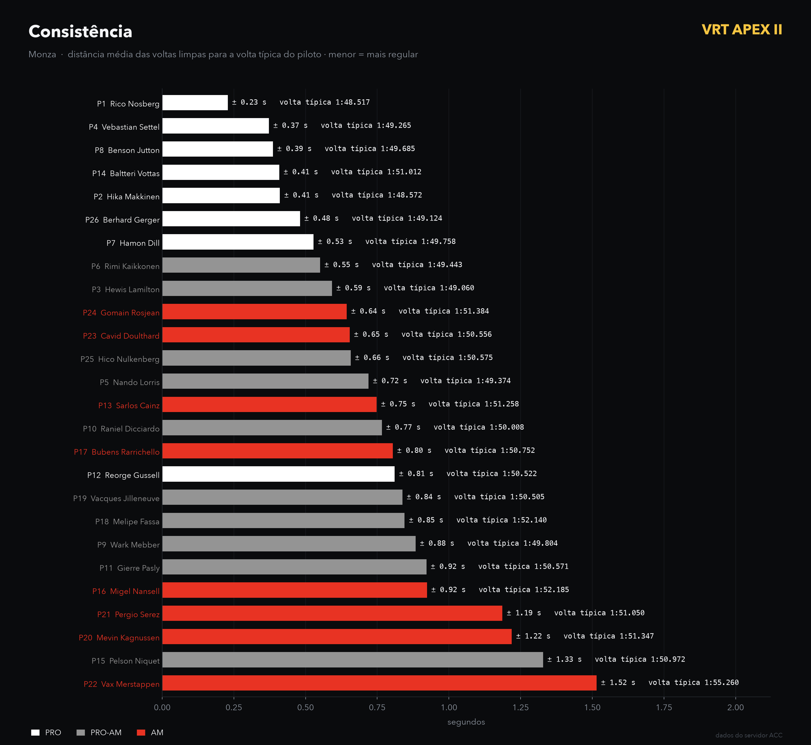](images/graficos/10-consistency.png)

**Como ler.** Barra curta é piloto que repete o mesmo tempo volta após volta. O número (± s) é o quanto, em média, cada
volta fugiu da volta típica, que aparece ao lado.

**No exemplo do Rico Nosberg.** **O mais regular da corrida**: ± 0,23 s em volta da volta típica de 1:48.517, que também
foi a melhor. O Hika Makkinen variou ± 0,41 s. É o gráfico que melhor explica a vitória.

## Melhor volta

`11-best-lap.png`

[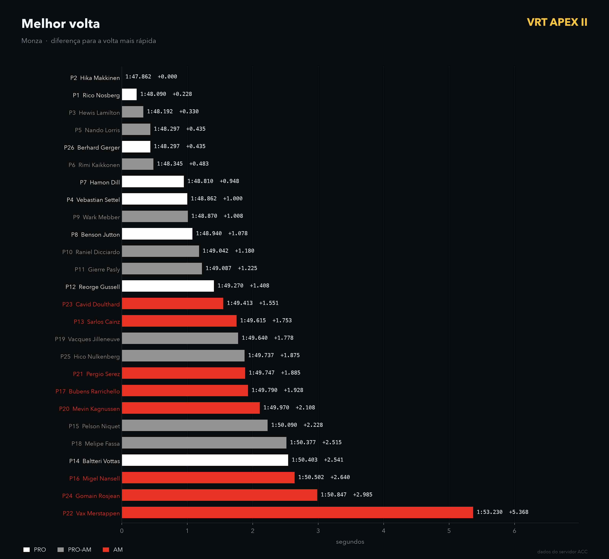](images/graficos/11-best-lap.png)

**Como ler.** A diferença da melhor volta de cada piloto para a mais rápida da corrida. É velocidade pura numa volta,
sem contar regularidade nem estratégia.

**No exemplo do Rico Nosberg.** **2º**, com 1:48.090, a 0,228 s do Hika Makkinen. Ele não precisou da volta mais rápida
para vencer.

## Posições volta a volta

`12-lap-by-lap.png`

[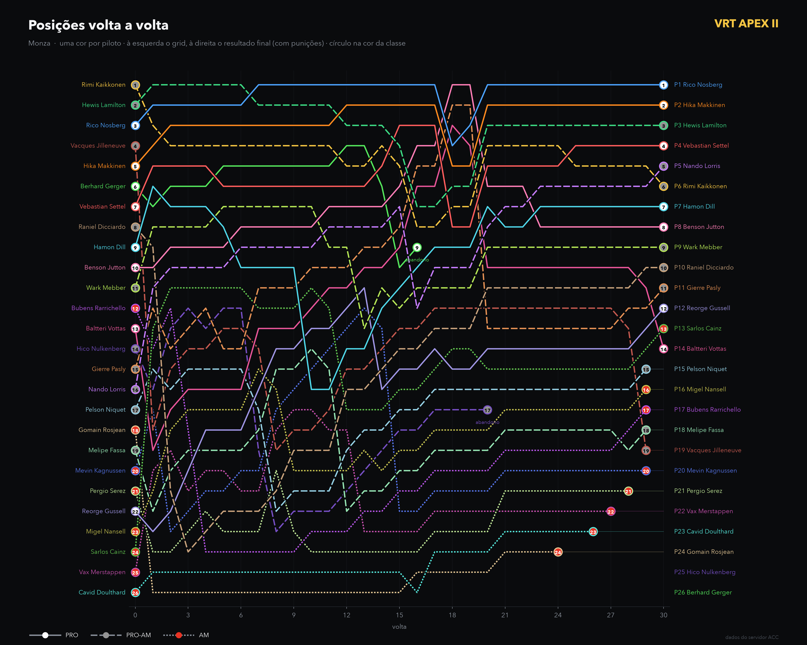](images/graficos/12-lap-by-lap.png)

**Como ler.** Siga a linha de um piloto da esquerda para a direita: subir é ganhar posição. Cada piloto tem uma cor, e o
traço (contínuo, tracejado, pontilhado) indica a categoria. À esquerda fica o grid, e à direita, o resultado final, com
as punições. Trocas em sequência no meio da corrida costumam ser o ciclo de paradas, não ultrapassagens.

**No exemplo do Rico Nosberg.** A linha azul: 3º no grid, 2º nas seis primeiras voltas, 1º da volta 7 em diante, 4º e 3º
nas voltas 18 e 19, enquanto quem ainda não tinha parado passava à frente, e de volta ao 1º na volta 20.

## Volta ideal

`13-ideal-lap.png`

[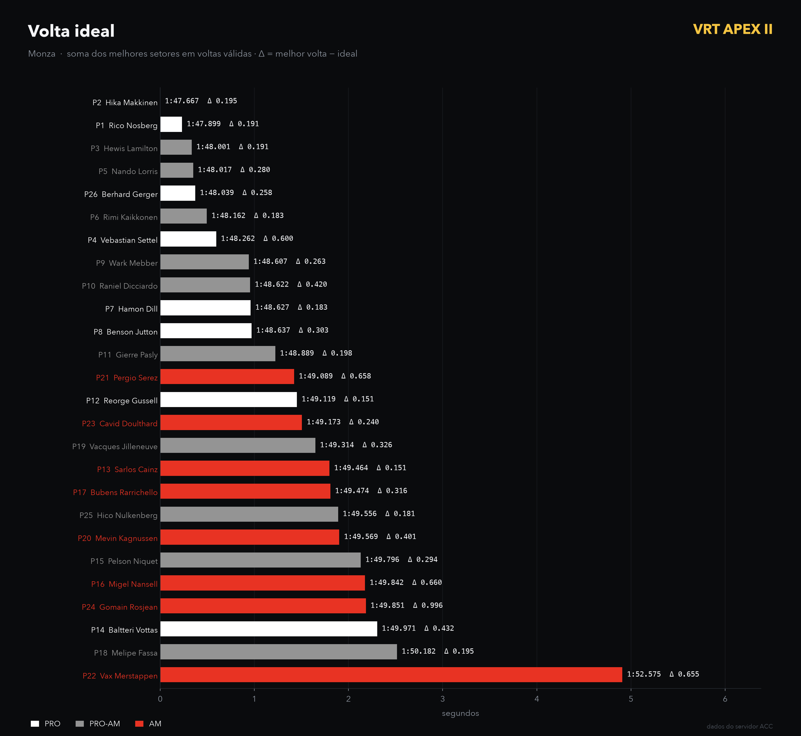](images/graficos/13-ideal-lap.png)

**Como ler.** A soma dos melhores setores de cada piloto em voltas válidas. O Δ é quanto tempo ficou na pista entre a
melhor volta e a ideal.

**No exemplo do Rico Nosberg.** Volta ideal de 1:47.899, a 2ª melhor, atrás da do Hika Makkinen (1:47.667). O Δ dele é
de 0,191 s: tinha um pouco mais de velocidade, mas preferiu voltas repetíveis a uma volta perfeita.

## Voltas invalidadas

`14-invalid-laps.png`

[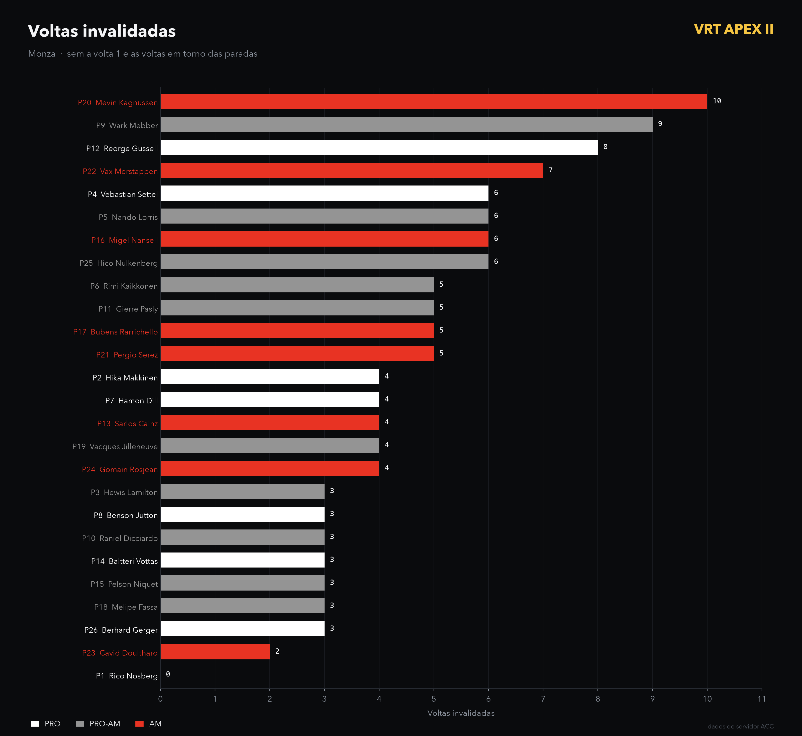](images/graficos/14-invalid-laps.png)

**Como ler.** Quantas voltas o jogo invalidou (por exemplo, por sair dos limites da pista), sem a volta 1 e as voltas em
torno das paradas. Barra maior, mais voltas no limite.

**No exemplo do Rico Nosberg.** **Nenhuma.** Foi o único piloto que terminou a corrida sem voltas invalidadas; o Hika
Makkinen teve 4.

## Melhores setores

`15-sectors.png`

[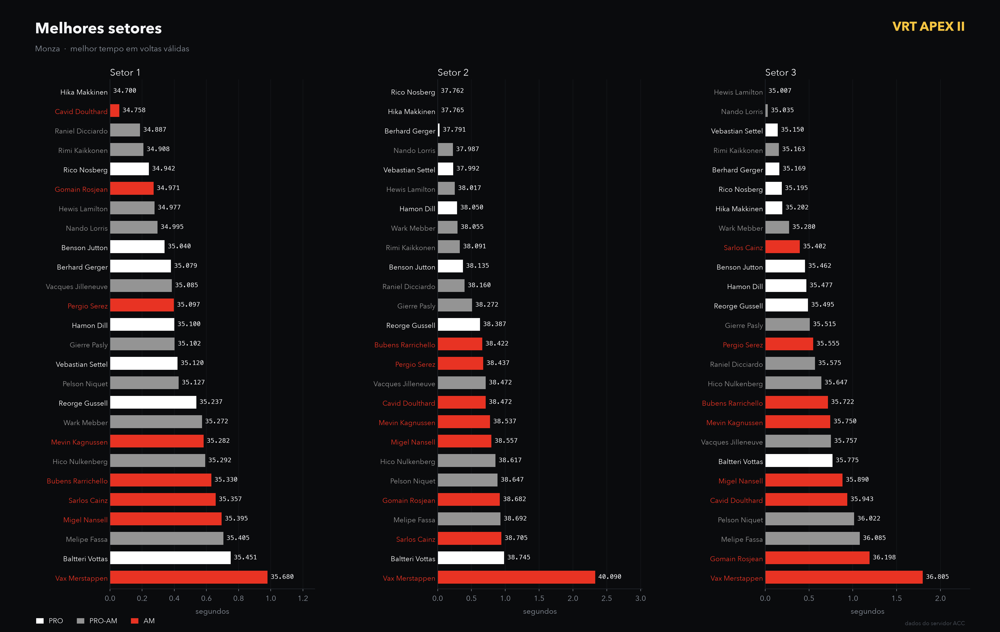](images/graficos/15-sectors.png)

**Como ler.** Um painel por setor, do mais rápido (em cima) para o mais lento. Mostra em que parte da pista cada piloto
é forte.

**No exemplo do Rico Nosberg.** **O mais rápido no setor 2** (37.762), 5º no setor 1 e 6º no setor 3. O Hika Makkinen
foi o melhor no setor 1 e o Hewis Lamilton, no setor 3.

## Distribuição do ritmo

`16-pace-distribution.png`

[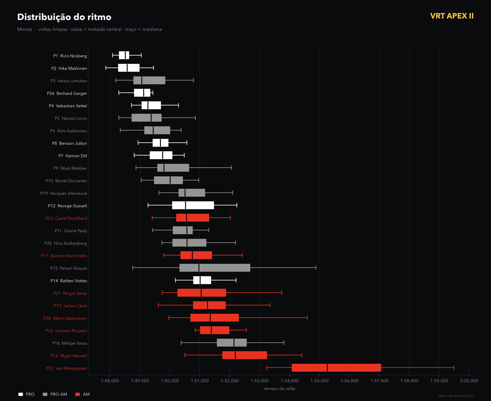](images/graficos/16-pace-distribution.png)

**Como ler.** A caixa é a metade central das voltas limpas, o traço é a mediana e as hastes vão até 1,5 × a caixa. Os
pilotos estão em ordem de ritmo: caixa à esquerda é ritmo rápido; caixa estreita é ritmo constante.

**No exemplo do Rico Nosberg.** O primeiro da lista, com a **caixa mais estreita**: o melhor ritmo e o mais constante ao
mesmo tempo.

## O que os gráficos contaram

O Rico Nosberg não fez a volta mais rápida nem a melhor volta ideal: as duas foram do Hika Makkinen. Ele venceu porque
foi o mais rápido **em média**, o mais constante e o mais limpo, sem nenhuma volta invalidada. Com as paradas na mesma
volta e com o mesmo tempo, o ritmo na pista decidiu a corrida.

Os detalhes técnicos de cada cálculo estão em [charts.md](charts.md) (em inglês).

[← Voltar para o início](../README.md)
